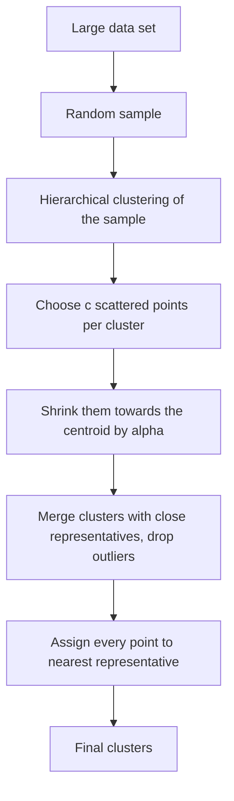

**In simple words:** CURE (Clustering Using REpresentatives) groups points into clusters. Instead of describing a cluster by one centre point (like k-means) or all of its points, CURE uses a few well-spread **representative points**, moved a little towards the centre. This lets it find clusters of any shape and ignore outliers. <Cite id="cure-stream-clustering-guha1998" /> <Cite id="cure-stream-clustering-tp-cure" />

**Why it is needed:** k-means finds only round clusters of similar size and is pulled by outliers; hierarchical clustering is too slow for huge data. CURE fixes both.

**Steps**

1. **Sample** the data randomly so it fits in memory (for huge data, partition the sample too).
2. **Cluster the sample** by hierarchical (agglomerative) clustering: start with each point as a cluster and repeatedly merge the closest pair.
3. **Pick representatives:** for each cluster choose $c$ well-scattered points (the first is the farthest from the centroid, the next is farthest from those already chosen, and so on).
4. **Shrink** each representative towards the cluster centroid by a fraction $\alpha$ (for example 0.2). This damps the effect of outliers.
5. **Merge** two clusters if any of their representatives are close; recompute the representatives. Remove very small, slowly growing clusters as outliers.
6. **Label all data:** every point in the full data set is assigned to the cluster of its nearest representative.

<Cite id="cure-stream-clustering-gfg-cure" loc="diagram" />

**Advantages over traditional clustering**

| Point | k-means / centroid methods | CURE |
|---|---|---|
| Cluster shape | Round (spherical) only | Arbitrary shapes, such as long or ring-like clusters |
| Cluster size | Prefers similar sizes | Handles different sizes |
| Outliers | Pull the centroid | Shrinking and outlier removal reduce their effect |
| Large data | Needs many passes over all data | Works on a sample plus one labelling pass |
| Representation | One centre | Several representatives per cluster |

**Limitation:** it needs the parameters $c$, $\alpha$ and the sample size, and works with Euclidean space. <Cite id="hadoop-ecosystem-mmds" />

**Conclusion:** by using shrunken representative points and sampling, CURE is more accurate on odd shapes, more robust to outliers and scalable.
