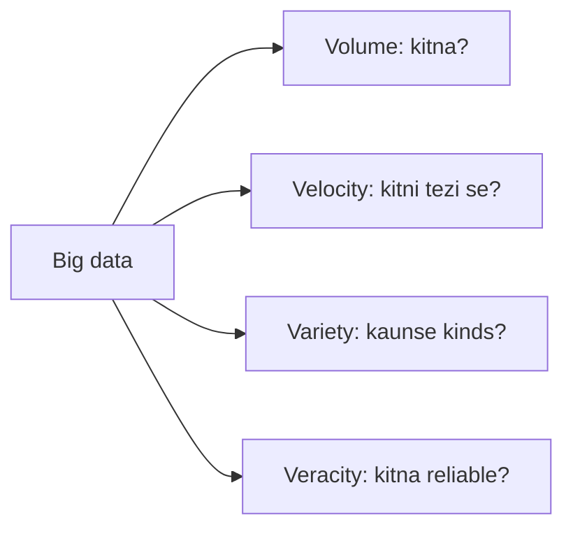

**In simple words:** big data woh data hai jo itna bada, itna fast ya itna messy hota hai ki ek normal computer aur normal database use store ya process nahi kar sakta. Ise "V"s se describe karte hain. Chaar main V hain: **Volume, Velocity, Variety aur Veracity**. <Cite id="big-data-intro-ibm" /> <Cite id="big-data-intro-gfg" />

**1. Volume (kitna).** Data ki matra bahut badi hoti hai: terabytes se petabytes tak. *Example:* Facebook pe users roz millions photos upload karte hain. Iske liye HDFS jaisa distributed storage chahiye, kyunki ek disk mein itna data nahi aata.

**2. Velocity (kitni tezi se).** Data tezi se aata hai aur aksar aate hi handle karna padta hai. *Example:* card transactions, sensor readings aur stock ticks har second aate hain, aur fraud seconds mein pakadna hota hai, dino mein nahi. Iske liye stream processing chahiye.

**3. Variety (kitne type ka).** Data kai forms mein aata hai: structured (tables), semi-structured (JSON, XML, logs) aur unstructured (text, images, video). *Example:* hospital ke paas patient tables, doctor notes aur X-ray images hoti hain. Iske liye NoSQL stores aur flexible tools chahiye, sirf rows aur columns nahi.

**4. Veracity (kitna bharosemand).** Data aksar incomplete, noisy, duplicate ya biased hota hai, to results galat ho sakte hain. *Example:* fake reviews ya kharab sensor. Analysis se pehle cleaning aur checking chahiye.

Kuch books paanchwa V, **Value**, bhi jodti hain (kya data ko use karne ka kharcha worth hai?). <Cite id="big-data-intro-wiki" />

**Conclusion:** chaar Vs batate hain ki big data ko naye tools (Hadoop, NoSQL, stream systems) kyun chahiye, sirf ek relational database kaafi nahi hai.

Exam mein English mein likho: "The four characteristics of big data are Volume, Velocity, Variety and Veracity."
