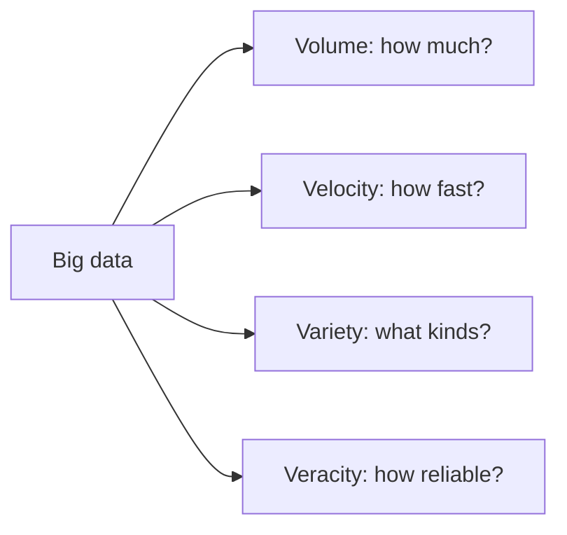

**In simple words:** big data is data so large, so fast or so messy that one normal computer and a normal database cannot store or process it. It is described by the "V"s. The four main ones are **Volume, Velocity, Variety and Veracity**. <Cite id="big-data-intro-ibm" /> <Cite id="big-data-intro-gfg" />

**1. Volume (how much).** The amount of data is huge: terabytes to petabytes. *Example:* Facebook users upload millions of photos every day. It needs distributed storage such as HDFS, because one disk cannot hold it.

**2. Velocity (how fast).** Data arrives quickly and must often be handled as it arrives. *Example:* card transactions, sensor readings and stock ticks arrive every second, and fraud must be caught in seconds, not days. It needs stream processing.

**3. Variety (how many kinds).** Data comes in many forms: structured (tables), semi-structured (JSON, XML, logs) and unstructured (text, images, video). *Example:* a hospital holds patient tables, doctor notes and X-ray images. It needs NoSQL stores and flexible tools, not only rows and columns.

**4. Veracity (how trustworthy).** Data is often incomplete, noisy, duplicated or biased, so results can be wrong. *Example:* fake reviews or a faulty sensor. It needs cleaning and checking before analysis.

Some books add a fifth V, **Value** (is the data worth the cost of using it?). <Cite id="big-data-intro-wiki" />

**Conclusion:** the four Vs explain why big data needs new tools (Hadoop, NoSQL, stream systems) instead of a single relational database.
