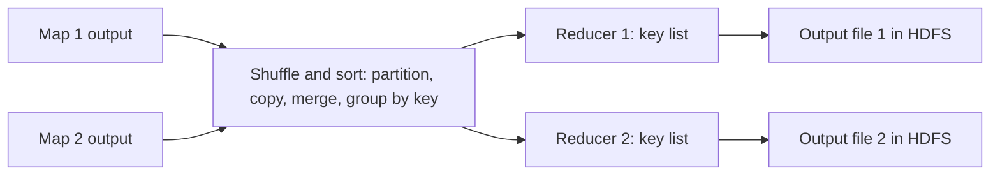

**In simple words:** map tasks khatam hone ke baad **shuffle and sort** phase ek key ki saari values ek jagah le aata hai aur keys ke hisaab se sort karta hai. Phir **reducer** har key ki values ko combine karke ek result banata hai. <Cite id="big-data-intro-mapreduce" loc="§3.1" /> <Cite id="hadoop-ecosystem-apache-mr-tutorial" />

**Shuffle and sort (framework karta hai, aapka code nahi).**

1. **Partition.** Har map output pair (key, value) ko ek reducer number milta hai, aam taur pe `hash(key) mod R`, jahan R reducers ki sankhya hai. Ek hi key hamesha ek hi reducer ke paas jaati hai.
2. **Spill and sort.** Map output memory mein rakha jaata hai, key ke hisaab se sort hota hai aur mapper ki local disk pe likha jaata hai.
3. **Shuffle (copy).** Har reducer har mapper se network ke through apna partition laata hai.
4. **Merge-sort and group.** Reducer laaye hue pieces ko merge karta hai taaki equal keys saath aa jaayein, aur (key, list of values) ban jaaye.

**Reducer phase.** `reduce` function har key ke liye ek baar chalta hai, us key ki values ki list ke saath. Ye unhe sum, count, join ya filter karta hai aur final pairs HDFS mein likhta hai, har reducer ki ek output file. <Cite id="mapreduce-gfg-mr" />

**Example (word count).** Map output: (big,1) (data,1) (big,1). Shuffle and sort ke baad: big → [1,1], data → [1]. Reducer output: (big,2) (data,1).

**Conclusion:** shuffle and sort equal keys ko saath laata hai; reducer har group ko ek answer mein badalta hai.

Exam mein English mein likho: "Shuffle and sort partitions, copies and sorts the map output by key; the reducer processes each key's list of values once."
