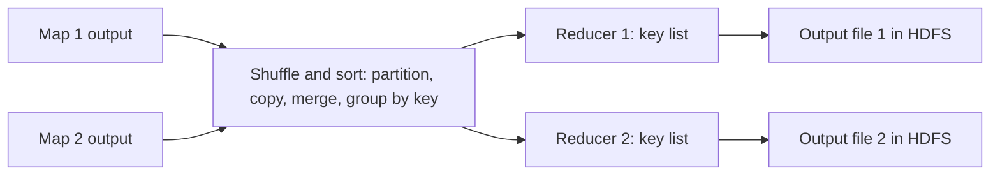

**In simple words:** after the map tasks finish, the **shuffle and sort** phase moves all the values of one key to one place and sorts them by key. The **reducer** then combines the values of each key into one result. <Cite id="big-data-intro-mapreduce" loc="§3.1" /> <Cite id="hadoop-ecosystem-apache-mr-tutorial" />

**Shuffle and sort (done by the framework, not by your code).**

1. **Partition.** Each map output pair (key, value) is given a reducer number, normally `hash(key) mod R`, where R is the number of reducers. The same key always goes to the same reducer.
2. **Spill and sort.** Map output is kept in memory, sorted by key and written to the mapper's local disk.
3. **Shuffle (copy).** Each reducer fetches its own partition from every mapper over the network.
4. **Merge-sort and group.** The reducer merges the fetched pieces so that equal keys sit together, giving (key, list of values).

**Reducer phase.** The `reduce` function is called once per key with the list of values for that key. It sums, counts, joins or filters them and writes the final pairs to HDFS, one output file per reducer. <Cite id="mapreduce-gfg-mr" />

**Example (word count).** Map output: (big,1) (data,1) (big,1). After shuffle and sort: big → [1,1], data → [1]. Reducer output: (big,2) (data,1).

**Conclusion:** shuffle and sort brings equal keys together; the reducer turns each group into one answer.
