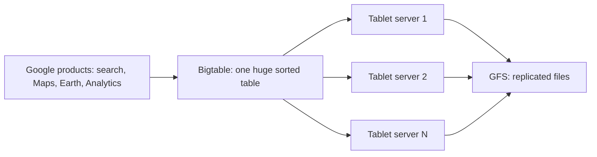

**In simple words:** Google ko web jitna bada data store aur search karna tha. Ek bade server pe normal relational database bahut slow aur mehnga tha, to Google ne **Bigtable** banaya, ek NoSQL store jo data ko hazaaron sasti machines pe failata hai. Ye wo standard case study hai jahan NoSQL ne business problem ko faster, cheaper aur better solve kiya. <Cite id="nosql-intro-bigtable" /> <Cite id="nosql-intro-wiki-bigtable" />

**Business drivers (Google ko ye kyun chahiye tha).** McCreary aur Kelly ke hisaab se NoSQL ke chaar drivers: <Cite id="big-data-intro-nosql" />

| Driver | In the Bigtable case |
| --- | --- |
| Volume | Web pages, maps aur satellite images ke petabytes; ek server se bahut zyada. |
| Velocity | Search aur Analytics jaise products se har second bahut saare reads aur writes. |
| Variability | Alag products ko alag columns chahiye; data ek fixed table mein fit nahi hota. |
| Agility | Teams ko naya data aur naye products jaldi add karne hain, har baar schema redesign kiye bina. |

**Isne problem kaise solve ki.**

1. Data ek bade sorted table mein rakha jaata hai, jise (row key, column, timestamp) se dhoondhte hain. Ye sparse map hai, to khaali cells ka koi cost nahi.
2. Table ko row ranges mein kaata jaata hai jinhe **tablets** kehte hain; ye bahut saare normal servers pe failte hain aur data badhne par rebalance hote hain.
3. Files Google File System pe rehti hain, to machine fail hone pe data nahi jaata.
4. Load badhe to Google bas aur commodity machines jod deta hai (scale out).

**Findings (results).**

- **Faster:** petabyte size pe bhi single-row reads aur writes fast rehte hain, kyunki har machine ke paas sirf chhota hissa hota hai.
- **Cheaper:** ye ek bahut mehngi machine ki jagah commodity servers ke clusters pe chalta hai.
- **More effective:** Bigtable paper batata hai ki Google Earth aur Analytics samet sixty se zyada Google products ise use karte hain, chhote se petabyte tak ke data ke liye. Ek hi design kai zarooraton ko poora karta hai. <Cite id="nosql-intro-bigtable" />

**Conclusion:** Bigtable dikhata hai ki jab volume, velocity, variability aur agility badhti hain, to scale-out NoSQL store speed, cost aur fit mein ek relational server se behtar hota hai. <Cite id="nosql-intro-gfg-intro" />

Exam mein English mein likho: "Bigtable solved Google's volume, velocity, variability and agility problems by scaling out on commodity servers."
