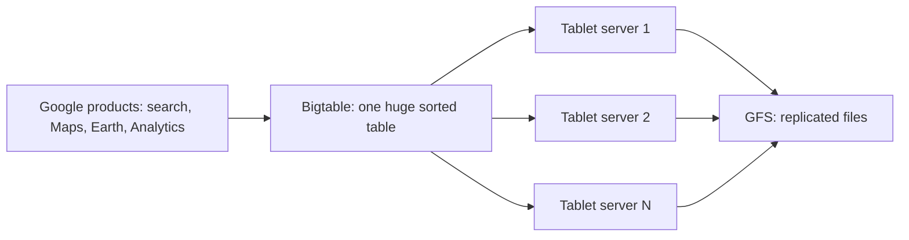

**In simple words:** Google had to store and search a web-sized amount of data. A normal relational database on one big server was too slow and too costly, so Google built **Bigtable**, a NoSQL store that spreads data over thousands of cheap machines. It is the standard case study of NoSQL solving a business problem faster, cheaper and better. <Cite id="nosql-intro-bigtable" /> <Cite id="nosql-intro-wiki-bigtable" />

**Business drivers (why Google needed it).** The four drivers of NoSQL named by McCreary and Kelly are: <Cite id="big-data-intro-nosql" />

| Driver | In the Bigtable case |
| --- | --- |
| Volume | Petabytes of web pages, maps and satellite images; far more than one server holds. |
| Velocity | Very many reads and writes per second from products such as search and Analytics. |
| Variability | Different products need different columns; the data does not fit one fixed table. |
| Agility | Teams must add new data and products quickly, without redesigning a schema each time. |

**How it solved the problem.**

1. Data is kept in one big sorted table, found by (row key, column, timestamp). It is a sparse map, so empty cells cost nothing.
2. The table is cut into row ranges called **tablets**, which are spread over many ordinary servers and rebalanced as data grows.
3. Files live on the Google File System, so a failed machine does not lose data.
4. To handle more load, Google simply adds more commodity machines (scale out).

**Findings (results).**

- **Faster:** reads and writes of single rows stay fast even at petabyte size, because each machine holds only a small part.
- **Cheaper:** it runs on clusters of commodity servers instead of one very costly machine.
- **More effective:** the Bigtable paper reports that more than sixty Google products, including Google Earth and Analytics, use it, with data sizes from small to petabytes. One design serves many needs. <Cite id="nosql-intro-bigtable" />

**Conclusion:** Bigtable shows that when volume, velocity, variability and agility grow, a scale-out NoSQL store beats a single relational server on speed, cost and fit. <Cite id="nosql-intro-gfg-intro" />
