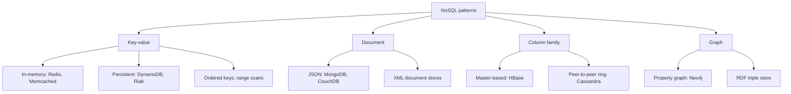

**In simple words:** NoSQL **architectural pattern** data ko organise karne ka ek standard tareeka hai jo kai machines pe scale ho sake. Chaar basic patterns hain: key-value, document, column family aur graph. Real products in patterns ko stretch karte hain, aur wahi stretched forms **variations** hain. <Cite id="big-data-intro-nosql" /> <Cite id="nosql-patterns-gfg-types" />

**Variations kyun hote hain.** Koi ek pattern har kaam ke liye fit nahi hota. Products base pattern mein speed, durability, ordering ya richer values jod dete hain.

<Cite id="nosql-patterns-gfg-types" loc="diagram" />

**Variations, pattern ke hisaab se.**

- **Key-value.** Store har key ke saath ek value rakhta hai, ek bade dictionary jaisa. Variations: *in-memory* stores aur caches (Redis, Memcached) sabse fast reads dete hain par crash pe data ja sakta hai; *persistent* stores (DynamoDB, Riak) disk pe likhte hain; *ordered* stores keys ko sorted rakhte hain taaki keys ki range padh sakein. Redis mein value list, set ya hash bhi ho sakti hai. <Cite id="nosql-patterns-redis-data" /> <Cite id="nosql-patterns-wiki-kv" />
- **Document.** Value ek self-describing document hota hai, aam taur pe JSON. Variations: JSON stores (MongoDB, CouchDB) aur XML stores; kuch search ya multi-document transactions bhi jodte hain. <Cite id="nosql-patterns-mongo-model" />
- **Column family.** Data column family aur row key se group hota hai, jaise Google Bigtable mein. Variations: master-based design (HBase) versus tunable consistency wala peer-to-peer ring (Cassandra). <Cite id="nosql-patterns-cass-model" />
- **Graph.** Data nodes aur relationships hota hai. Variations: *property graph* (Neo4j) aur *RDF triple store* (subject, predicate, object), jo semantic web ke liye use hota hai. <Cite id="nosql-patterns-wiki-graph" />
- **Multi-model aur mixed use.** Ek product kai patterns deta hai, ya application har zaroorat ke liye alag store use karti hai (polyglot persistence).

| Pattern | Best for | Example product |
| --- | --- | --- |
| Key-value | Caches, sessions, shopping carts | Redis, DynamoDB |
| Document | Catalogues, user profiles, content | MongoDB |
| Column family | Huge write-heavy tables, logs | Cassandra, HBase |
| Graph | Social links, recommendations, fraud | Neo4j |

**Conclusion:** chaar patterns base hain; unke variations speed, durability, consistency aur data ki richness mein trade-off karte hain, isliye workload dekh kar pattern aur variation chunte hain.

Exam mein English mein likho: "NoSQL patterns are key-value, document, column family and graph, each with variations that trade speed, durability and consistency."
