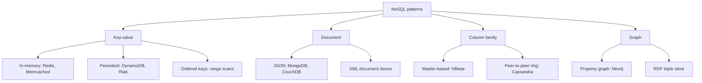

**In simple words:** a NoSQL **architectural pattern** is a standard way of organising data so that it scales over many machines. There are four basic patterns: key-value, document, column family and graph. Real products stretch these patterns, and those stretched forms are the **variations**. <Cite id="big-data-intro-nosql" /> <Cite id="nosql-patterns-gfg-types" />

**Why variations exist.** No single pattern suits every job. Products add speed, durability, ordering or richer values to a base pattern to fit their use.

<Cite id="nosql-patterns-gfg-types" loc="diagram" />

**The variations, pattern by pattern.**

- **Key-value.** The store keeps one value per key, like a giant dictionary. Variations: *in-memory* stores and caches (Redis, Memcached) give the fastest reads but may lose data on a crash; *persistent* stores (DynamoDB, Riak) write to disk; *ordered* stores keep keys sorted so a range of keys can be read. Redis even lets the value be a list, set or hash. <Cite id="nosql-patterns-redis-data" /> <Cite id="nosql-patterns-wiki-kv" />
- **Document.** The value is a self-describing document, usually JSON. Variations: JSON stores (MongoDB, CouchDB) and XML stores; some add search or multi-document transactions. <Cite id="nosql-patterns-mongo-model" />
- **Column family.** Data is grouped by column family and row key, as in Google Bigtable. Variations: a master-based design (HBase) versus a peer-to-peer ring with tunable consistency (Cassandra). <Cite id="nosql-patterns-cass-model" />
- **Graph.** Data is nodes and relationships. Variations: the *property graph* (Neo4j) and the *RDF triple store* (subject, predicate, object), used for the semantic web. <Cite id="nosql-patterns-wiki-graph" />
- **Multi-model and mixed use.** One product offers several patterns, or an application uses a different store for each need (polyglot persistence).

| Pattern | Best for | Example product |
| --- | --- | --- |
| Key-value | Caches, sessions, shopping carts | Redis, DynamoDB |
| Document | Catalogues, user profiles, content | MongoDB |
| Column family | Huge write-heavy tables, logs | Cassandra, HBase |
| Graph | Social links, recommendations, fraud | Neo4j |

**Conclusion:** the four patterns are the base; their variations trade speed, durability, consistency and richness of data, so we choose the pattern and variation by the workload.
