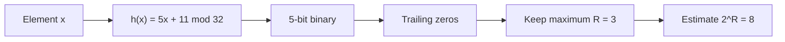

**In simple words:** Flajolet-Martin (FM) stream ke **distinct** elements ki sankhya ka estimate deta hai, unhe store kiye bina. Har element ko binary number mein hash karo aur uske **trailing zeros** (right end ke zeros) gino. Dekhe gaye sabse bade count ko $R$ kaho, to distinct elements ka estimate $2^R$ hai. Idea ye hai: $R$ zeros pe khatam hone wali hash value lagbhag $2^R$ mein se 1 element ki hoti hai, isliye $R$ dikhne ka matlab lagbhag $2^R$ alag elements guzre. <Cite id="stream-counting-fm1985" /> <Cite id="stream-counting-mmds-home" loc="§4.4" />

**Algorithm ke steps.**

1. Ek hash function chuno aur har element pe lagao.
2. Hash value ko 5-bit binary number likho.
3. Har ek ke trailing zeros gino; maximum $R$ rakho.
4. Distinct count ka estimate $2^R$ do.

<Sum>

<Given>

Stream $S = \{10, 12, 8, 15, 6, 9, 14, 7\}$. Hash $h(x) = (5x + 11) \bmod 32$, 5-bit binary number ke roop mein.

</Given>

<Find>

distinct elements ki sankhya ka Flajolet-Martin estimate.

</Find>

<Steps>

1. Har element ke liye $5x + 11$ nikalo, phir mod 32 lo. *Reason: ye diya hua hash function hai.*
2. Har result ko 5 bits mein likho aur right end ke zeros gino. *Reason: FM sirf zeros ki tail dekhta hai.*

| $x$ | $5x + 11$ | mod 32 | 5-bit binary | trailing zeros |
| --- | --- | --- | --- | --- |
| 10 | 61 | 29 | 11101 | 0 |
| 12 | 71 | 7 | 00111 | 0 |
| 8 | 51 | 19 | 10011 | 0 |
| 15 | 86 | 22 | 10110 | 1 |
| 6 | 41 | 9 | 01001 | 0 |
| 9 | 56 | 24 | 11000 | 3 |
| 14 | 81 | 17 | 10001 | 0 |
| 7 | 46 | 14 | 01110 | 1 |

3. Sabse zyada trailing zeros $R = 3$ hain ($x = 9$ se). *Reason: FM sirf maximum rakhta hai.*
4. Estimate $= 2^R = 2^3 = 8$. *Reason: FM estimate formula.*

</Steps>

<Answer>

distinct elements ka estimate $8$ hai.

</Answer>

<Box kind="verify">

Check 1 (mod 32 dobara): $61 - 32 = 29$, $71 - 64 = 7$, $51 - 32 = 19$, $86 - 64 = 22$, $41 - 32 = 9$, $56 - 32 = 24$, $81 - 64 = 17$, $46 - 32 = 14$. Table se match karta hai.

Check 2 (binary ke bina trailing zeros): kisi number ke $k$ trailing zeros tab hote hain jab wo $2^k$ se divisible ho par $2^{k+1}$ se nahi. $24 = 8 \times 3$ ke 3; $22 = 2 \times 11$ aur $14 = 2 \times 7$ ke 1; baaki paanch values odd hain, to 0. Isliye $R = 3$.

Check 3: stream mein 8 elements hain, sab alag, to true count 8 hai aur estimate match karta hai. Ye kuch had tak luck hai: ek hash function sirf rough estimate deta hai, isliye practice mein kai hash functions use karte hain, groups ke andar average lete hain aur group averages ka median lete hain. <Cite id="stream-counting-gfg-fm" />

</Box>

</Sum>

**Conclusion:** maximum tail length $R = 3$ lagbhag $2^3 = 8$ distinct elements deti hai, memory mein sirf ek chhoti number rakhkar. <Cite id="stream-counting-wiki-fm" />

Exam mein English mein likho: "FM estimates the distinct count as 2 to the power of the maximum number of trailing zeros, here 2^3 = 8."
