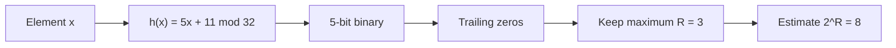

**In simple words:** Flajolet-Martin (FM) estimates how many **distinct** elements a stream has without storing them. Hash every element to a binary number and count its **trailing zeros** (zeros at the right end). If the largest count seen is $R$, the estimate of distinct elements is $2^R$. The idea: a hash value ending in $R$ zeros happens for about 1 element in $2^R$, so seeing $R$ means roughly $2^R$ different elements went by. <Cite id="stream-counting-fm1985" /> <Cite id="stream-counting-mmds-home" loc="§4.4" />

**Steps of the algorithm.**

1. Pick a hash function and apply it to each element.
2. Write the hash value as a 5-bit binary number.
3. Count the trailing zeros of each; keep the maximum $R$.
4. Estimate the distinct count as $2^R$.

<Sum>

<Given>

Stream $S = \{10, 12, 8, 15, 6, 9, 14, 7\}$. Hash $h(x) = (5x + 11) \bmod 32$, written as a 5-bit binary number.

</Given>

<Find>

the Flajolet-Martin estimate of the number of distinct elements.

</Find>

<Steps>

1. Compute $5x + 11$ for each element, then take it mod 32. *Reason: this is the given hash function.*
2. Write each result in 5 bits and count the zeros at the right end. *Reason: FM looks only at the tail of zeros.*

| $x$ | $5x + 11$ | mod 32 | 5-bit binary | trailing zeros |
| --- | --- | --- | --- | --- |
| 10 | 61 | 29 | 11101 | 0 |
| 12 | 71 | 7 | 00111 | 0 |
| 8 | 51 | 19 | 10011 | 0 |
| 15 | 86 | 22 | 10110 | 1 |
| 6 | 41 | 9 | 01001 | 0 |
| 9 | 56 | 24 | 11000 | 3 |
| 14 | 81 | 17 | 10001 | 0 |
| 7 | 46 | 14 | 01110 | 1 |

3. The largest number of trailing zeros is $R = 3$ (from $x = 9$). *Reason: FM keeps only the maximum.*
4. Estimate $= 2^R = 2^3 = 8$. *Reason: the FM estimate formula.*

</Steps>

<Answer>

the estimated number of distinct elements is $8$.

</Answer>

<Box kind="verify">

Check 1 (reduce mod 32 again): $61 - 32 = 29$, $71 - 64 = 7$, $51 - 32 = 19$, $86 - 64 = 22$, $41 - 32 = 9$, $56 - 32 = 24$, $81 - 64 = 17$, $46 - 32 = 14$. These match the table.

Check 2 (trailing zeros without binary): a number has $k$ trailing zeros when it is divisible by $2^k$ but not by $2^{k+1}$. $24 = 8 \times 3$ gives 3; $22 = 2 \times 11$ and $14 = 2 \times 7$ give 1; the other five values are odd, so 0. So $R = 3$.

Check 3: the stream has 8 elements, all different, so the true count is 8 and the estimate agrees. This is partly luck: one hash function gives only a rough estimate, so in practice we use many hash functions, average within groups and take the median of the group averages. <Cite id="stream-counting-gfg-fm" />

</Box>

</Sum>

**Conclusion:** the maximum tail length $R = 3$ gives about $2^3 = 8$ distinct elements, keeping only one small number in memory. <Cite id="stream-counting-wiki-fm" />
