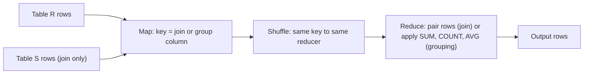

**In simple words:** MapReduce bade tables pe database operations kar sakta hai. Trick ye hai ki map output ki **key** wahi rakho jisse match karna hai (join column) ya jisse group karna hai (grouping column). Shuffle matching rows ko saath laata hai, aur reducer kaam poora karta hai. <Cite id="big-data-intro-mmds" loc="§2.3" /> <Cite id="mapreduce-algorithms-gfg-relalg" />

**1. Natural join** $R(A, B) \bowtie S(B, C)$ do tables ko unke common column $B$ pe jodta hai aur wahi rows rakhta hai jahan $B$ barabar ho.

- **Map:** $R$ ki har row $(a, b)$ ke liye key $b$ aur value $(R, a)$ emit karo. $S$ ki har row $(b, c)$ ke liye key $b$ aur value $(S, c)$ emit karo. Tag R ya S reducer ko batata hai ki value kis table se aayi.
- **Shuffle:** same $b$ wali saari values ek reducer pe milti hain.
- **Reduce:** har key $b$ ke liye har R value ko har S value ke saath pair karo aur $(a, b, c)$ output do.

**2. Grouping and aggregation** $\gamma_{A,\ \theta(B)}(R)$ rows ko $A$ se group karta hai aur $B$ pe SUM, COUNT, AVG, MIN ya MAX jaisa aggregate $\theta$ lagata hai.

- **Map:** har row $(a, b)$ ke liye key $a$ aur value $b$ emit karo.
- **Shuffle:** ek group $a$ ki saari $b$ values ek reducer pe milti hain.
- **Reduce:** $b$ values ki list pe $\theta$ lagao aur $(a, \theta(\text{list}))$ output do.

<Sum>

<Given>

Orders(OrderId, CustId): (1, C1), (2, C2), (3, C1). Customers(CustId, City): (C1, Pune), (C2, Delhi). Sales(Dept, Amount): (D1, 10), (D2, 5), (D1, 20), (D2, 15), (D1, 30).

</Given>

<Find>

Orders aur Customers ka natural join, aur har Dept ke Amount ka SUM.

</Find>

<Steps>

1. **Join map.** Orders se C1 → (O, 1), C2 → (O, 2), C1 → (O, 3). Customers se C1 → (C, Pune), C2 → (C, Delhi). *Reason: key join column CustId hai.*
2. **Join shuffle.** C1 → [(O,1), (O,3), (C,Pune)]; C2 → [(O,2), (C,Delhi)]. *Reason: equal keys group hoti hain.*
3. **Join reduce.** C1: orders 1 aur 3 Pune ke saath pair hote hain; C2: order 2 Delhi ke saath. Output (1, C1, Pune), (3, C1, Pune), (2, C2, Delhi). *Reason: har order value ko har customer value ke saath pair karte hain.*
4. **Grouping map.** D1 → 10, D2 → 5, D1 → 20, D2 → 15, D1 → 30 emit karo. *Reason: key grouping column hai.*
5. **Grouping shuffle.** D1 → [10, 20, 30]; D2 → [5, 15]. *Reason: equal keys group hoti hain.*
6. **Grouping reduce.** D1: $10 + 20 + 30 = 60$; D2: $5 + 15 = 20$. *Reason: SUM list ko jodta hai.*

</Steps>

<Answer>

join result: (1, C1, Pune), (2, C2, Delhi), (3, C1, Pune). Dept ke hisaab se SUM: D1 = 60, D2 = 20.

</Answer>

<Box kind="verify">

Check 1: har order ka theek ek matching customer hai, to join mein 3 rows honi chahiye, jitne orders hain.

Check 2: amounts ka total $10 + 5 + 20 + 15 + 30 = 80$ hai, aur group sums ka total $60 + 20 = 80$.

</Box>

</Sum>

**Notes.** Join ke liye mapper ko table ka naam (R ya S tag) chahiye. Reducer ek key ki saari values rakhta hai, to bahut common key (skew) ek reducer ko overload kar sakti hai. Aggregation mein **combiner** map side pe pehle partial sums jod sakta hai, to network pe kam data jaata hai (SUM, COUNT, MIN, MAX ke liye kaam karta hai). <Cite id="mapreduce-algorithms-wiki-join" />

**Conclusion:** join, join column ko key banata hai aur reducer mein tagged rows pair karta hai; grouping, group column ko key banata hai aur reducer mein aggregate lagata hai.

Exam mein English mein likho: "For a join, the map emits the join column as key with a table tag; the reducer pairs the R and S values of each key."
