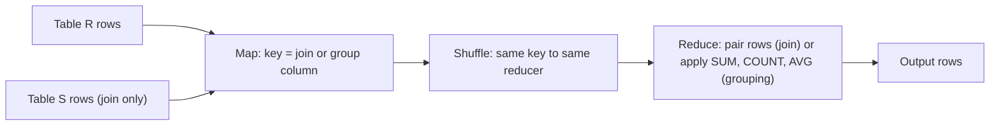

**In simple words:** MapReduce can do database operations on huge tables. The trick is to make the **key** of the map output the thing we want to match (the join column) or group by (the grouping column). The shuffle then brings the matching rows together, and the reducer finishes the work. <Cite id="big-data-intro-mmds" loc="§2.3" /> <Cite id="mapreduce-algorithms-gfg-relalg" />

**1. Natural join** $R(A, B) \bowtie S(B, C)$ joins two tables on their common column $B$ and keeps rows where $B$ is equal.

- **Map:** for each row $(a, b)$ of $R$ emit key $b$ with value $(R, a)$. For each row $(b, c)$ of $S$ emit key $b$ with value $(S, c)$. The tag R or S tells the reducer which table a value came from.
- **Shuffle:** all values with the same $b$ meet at one reducer.
- **Reduce:** for each key $b$, pair every R value with every S value and output $(a, b, c)$.

**2. Grouping and aggregation** $\gamma_{A,\ \theta(B)}(R)$ groups rows by $A$ and applies an aggregate $\theta$ such as SUM, COUNT, AVG, MIN or MAX on $B$.

- **Map:** for each row $(a, b)$ emit key $a$ with value $b$.
- **Shuffle:** all $b$ values of one group $a$ meet at one reducer.
- **Reduce:** apply $\theta$ to the list of $b$ values and output $(a, \theta(\text{list}))$.

<Sum>

<Given>

Orders(OrderId, CustId): (1, C1), (2, C2), (3, C1). Customers(CustId, City): (C1, Pune), (C2, Delhi). Sales(Dept, Amount): (D1, 10), (D2, 5), (D1, 20), (D2, 15), (D1, 30).

</Given>

<Find>

the natural join of Orders and Customers, and the SUM of Amount for each Dept.

</Find>

<Steps>

1. **Join map.** Orders give C1 → (O, 1), C2 → (O, 2), C1 → (O, 3). Customers give C1 → (C, Pune), C2 → (C, Delhi). *Reason: the key is the join column CustId.*
2. **Join shuffle.** C1 → [(O,1), (O,3), (C,Pune)]; C2 → [(O,2), (C,Delhi)]. *Reason: equal keys are grouped.*
3. **Join reduce.** C1: orders 1 and 3 pair with Pune; C2: order 2 pairs with Delhi. Output (1, C1, Pune), (3, C1, Pune), (2, C2, Delhi). *Reason: pair every order value with every customer value.*
4. **Grouping map.** Emit D1 → 10, D2 → 5, D1 → 20, D2 → 15, D1 → 30. *Reason: the key is the grouping column.*
5. **Grouping shuffle.** D1 → [10, 20, 30]; D2 → [5, 15]. *Reason: equal keys are grouped.*
6. **Grouping reduce.** D1: $10 + 20 + 30 = 60$; D2: $5 + 15 = 20$. *Reason: SUM adds the list.*

</Steps>

<Answer>

join result: (1, C1, Pune), (2, C2, Delhi), (3, C1, Pune). SUM by Dept: D1 = 60, D2 = 20.

</Answer>

<Box kind="verify">

Check 1: every order has exactly one matching customer, so the join must have 3 rows, the same as the 3 orders.

Check 2: the amounts add to $10 + 5 + 20 + 15 + 30 = 80$, and the group sums add to $60 + 20 = 80$.

</Box>

</Sum>

**Notes.** For the join, the mapper needs the table name (the R or S tag). Because a reducer holds all values of a key, a key that is very common (skew) can overload one reducer. For aggregation, a **combiner** can add partial sums on the map side first, so less data crosses the network (this works for SUM, COUNT, MIN and MAX). <Cite id="mapreduce-algorithms-wiki-join" />

**Conclusion:** join uses the join column as the key and pairs the tagged rows in the reducer; grouping uses the group column as the key and applies the aggregate in the reducer.
