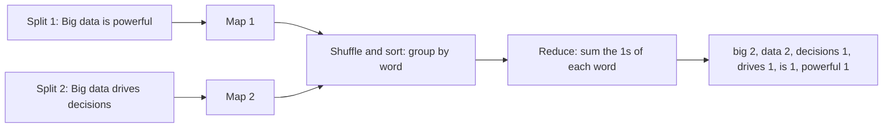

**In simple words:** word count poochta hai ki har word kitni baar aaya. **Map** step har word ko pair (word, 1) mein badalta hai. Framework equal words ko group karta hai. **Reduce** step har word ke 1s jodta hai. <Cite id="big-data-intro-mapreduce" loc="§2.1" /> <Cite id="mapreduce-gfg-wordcount" />

**Pseudocode** (MapReduce paper jaisa):

```
map(String key, String value):
    // key: document name, value: document contents
    for each word w in value:
        EmitIntermediate(w, 1)

reduce(String key, Iterator values):
    // key: a word, values: a list of counts
    result = 0
    for each v in values:
        result = result + v
    Emit(key, result)
```

**Assumption (jaise paper allow karta hai):** words lower case mein badal diye aur full stops hata diye, to "Big" aur "big" ek hi word hain. Document ko do lines mein baanta hai, har map task ke liye ek.

<Sum>

<Given>

Document: "Big data is powerful. Big data drives decisions." Split 1: "Big data is powerful". Split 2: "Big data drives decisions".

</Given>

<Find>

upar ke map, shuffle aur reduce steps se har word ka count.

</Find>

<Steps>

1. **Map 1** split 1 pe emit karta hai (big,1) (data,1) (is,1) (powerful,1). *Reason: har word ka ek pair.*
2. **Map 2** split 2 pe emit karta hai (big,1) (data,1) (drives,1) (decisions,1). *Reason: wahi rule.*
3. **Shuffle and sort** equal keys ko group aur sort karta hai:

| Key | Grouped values |
| --- | --- |
| big | [1, 1] |
| data | [1, 1] |
| decisions | [1] |
| drives | [1] |
| is | [1] |
| powerful | [1] |

4. **Reduce** har list jodta hai: big = 1 + 1 = 2, data = 1 + 1 = 2, decisions = 1, drives = 1, is = 1, powerful = 1. *Reason: reduce ek word ke counts ka sum karta hai.*

</Steps>

<Answer>

(big, 2), (data, 2), (decisions, 1), (drives, 1), (is, 1), (powerful, 1)

</Answer>

<Box kind="verify">

Check 1: sentence mein 4 + 4 = 8 words hain, aur counts ka total $2 + 2 + 1 + 1 + 1 + 1 = 8$.

Check 2: map ne 8 pairs emit kiye, har word ka ek, aur 6 distinct words hi 6 output lines hain.

</Box>

</Sum>



**Conclusion:** map (word, 1) pairs banata hai aur reduce unhe jodta hai, to document se big = 2, data = 2 aur baaki chaar words ek-ek baar aate hain. <Cite id="mapreduce-gfg-mr" />

Exam mein English mein likho: "Map emits (word, 1) for every word and reduce sums the values of each word."
