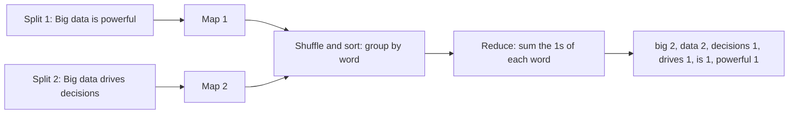

**In simple words:** word count asks how many times each word appears. The **map** step turns every word into a pair (word, 1). The framework groups equal words. The **reduce** step adds the 1s of each word. <Cite id="big-data-intro-mapreduce" loc="§2.1" /> <Cite id="mapreduce-gfg-wordcount" />

**Pseudocode** (as in the MapReduce paper):

```
map(String key, String value):
    // key: document name, value: document contents
    for each word w in value:
        EmitIntermediate(w, 1)

reduce(String key, Iterator values):
    // key: a word, values: a list of counts
    result = 0
    for each v in values:
        result = result + v
    Emit(key, result)
```

**Assumption (stated as the paper allows):** words are changed to lower case and the full stops are removed, so "Big" and "big" are the same word. The document is split into two lines, one for each map task.

<Sum>

<Given>

Document: "Big data is powerful. Big data drives decisions." Split 1: "Big data is powerful". Split 2: "Big data drives decisions".

</Given>

<Find>

the count of every word using the map, shuffle and reduce steps above.

</Find>

<Steps>

1. **Map 1** on split 1 emits (big,1) (data,1) (is,1) (powerful,1). *Reason: one pair per word.*
2. **Map 2** on split 2 emits (big,1) (data,1) (drives,1) (decisions,1). *Reason: the same rule.*
3. **Shuffle and sort** groups equal keys and sorts them:

| Key | Grouped values |
| --- | --- |
| big | [1, 1] |
| data | [1, 1] |
| decisions | [1] |
| drives | [1] |
| is | [1] |
| powerful | [1] |

4. **Reduce** adds each list: big = 1 + 1 = 2, data = 1 + 1 = 2, decisions = 1, drives = 1, is = 1, powerful = 1. *Reason: reduce sums the counts of one word.*

</Steps>

<Answer>

(big, 2), (data, 2), (decisions, 1), (drives, 1), (is, 1), (powerful, 1)

</Answer>

<Box kind="verify">

Check 1: the sentence has 4 + 4 = 8 words, and the counts add to $2 + 2 + 1 + 1 + 1 + 1 = 8$.

Check 2: map emitted 8 pairs, one per word, and the 6 distinct words are the 6 output lines.

</Box>

</Sum>



**Conclusion:** map makes (word, 1) pairs and reduce adds them, so the document gives big = 2, data = 2 and the other four words once each. <Cite id="mapreduce-gfg-mr" />
