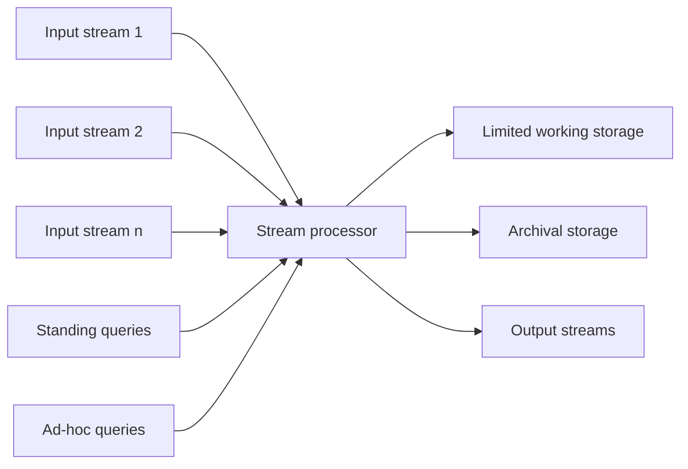

**In simple words:** **Data Stream Management System (DSMS)** tez, kabhi khatam na hone wali streams leta hai aur data ke guzarte hue us par sawaalon ke jawab deta hai, sirf chhoti memory se. Ye DBMS jaisa hai, par yahan data queries ke paas aata hai, queries stored data ke paas nahi jaatin. <Cite id="stream-data-model-cs246-slides" loc="slide 7" /> <Cite id="stream-data-model-wiki-dsms" />

**Ye kyun chahiye.** Normal DBMS pehle data store karta hai, baad mein query karta hai. Stream itni tez aur badi hoti hai ki store nahi ho sakti, aur jawab abhi chahiye (jaise sensor se fault alarm).

<Cite id="stream-data-model-cs246-slides" loc="diagram" />

**Parts aur ye kaise kaam karte hain.**

1. **Input streams.** Kai streams alag rates pe aati hain. Har stream elements ki sequence hai, jaise tuples ya bits.
2. **Stream processor.** Core engine. Ye har aane wale element ko ek baar dekhta hai aur apne answers update karta hai.
3. **Standing queries.** Stored queries jo hamesha chalti hain aur kuch naya hone par output deti hain, jaise "ab tak ka maximum temperature batao".
4. **Ad-hoc queries.** Sawaal jo ek baar, user ke chune hue time pe poochhe jaate hain, jaise "last 10 minutes mein kitne users login hue?". Ye sirf working store ka data use kar sakti hain.
5. **Limited working storage.** Main memory (ya thodi disk) jo summary rakhti hai: counts, sample ya recent elements ki window. Poori stream isme nahi aati.
6. **Archival storage.** Bada, slow store (tape ya warehouse) jahan stream copy ho sakti hai. Queries ka jawab dene ke liye ye bahut slow hai; baad ke offline analysis ke liye hai.
7. **Output.** Standing aur ad-hoc queries ke answers yahan se nikalte hain.

**DBMS versus DSMS.**

| | DBMS | DSMS |
| --- | --- | --- |
| Data | Stored, finite tables | Continuous, unbounded streams |
| Queries | Stored data pe ek baar | Standing queries lagatar chalti hain |
| Result | Exact | Aksar approximate |
| Storage | Poora data disk pe | Memory mein chhoti summary |
| Speed | Ready hone par answer | Real time |

<Cite id="stream-data-model-gfg-dbms-dsms" />

**Conclusion:** DSMS har element ko aate hi process karta hai, sirf chhoti summary rakhta hai aur baad ke analysis ke liye archive use karta hai. <Cite id="stream-data-model-geisler" />

Exam mein English mein likho: "A DSMS has input streams, a stream processor with standing and ad-hoc queries, limited working storage, archival storage and an output."
