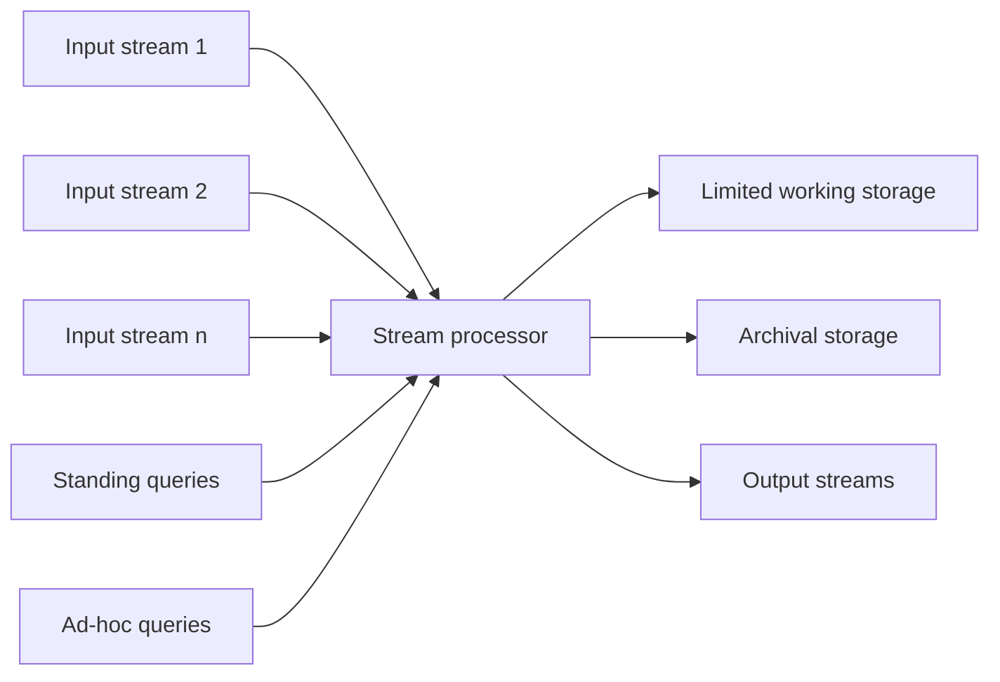

**In simple words:** a **Data Stream Management System (DSMS)** takes in fast, never-ending streams and answers questions about them while the data flows past, using only a small memory. It is like a DBMS, but the data comes to the queries instead of the queries going to stored data. <Cite id="stream-data-model-cs246-slides" loc="slide 7" /> <Cite id="stream-data-model-wiki-dsms" />

**Why it is needed.** A normal DBMS stores data first and queries it later. A stream is too fast and too big to store, and answers are needed now (for example a fault alarm from a sensor).

<Cite id="stream-data-model-cs246-slides" loc="diagram" />

**Parts and how they work.**

1. **Input streams.** Many streams arrive at different rates. Each is a sequence of elements, such as tuples or bits.
2. **Stream processor.** The core engine. It looks at every arriving element once and updates its answers.
3. **Standing queries.** Stored queries that run all the time and give output whenever there is something new, for example "report the maximum temperature so far".
4. **Ad-hoc queries.** Questions asked once, at a moment the user chooses, for example "how many users logged in in the last 10 minutes?". They can only use what the working store holds.
5. **Limited working storage.** Main memory (or a little disk) that holds a summary: counts, a sample or a window of recent elements. It cannot hold the whole stream.
6. **Archival storage.** A large, slow store (tape or warehouse) where the stream may be copied. It is too slow to answer queries; it is used for later offline analysis.
7. **Output.** Answers from standing and ad-hoc queries leave here.

**DBMS versus DSMS.**

| | DBMS | DSMS |
| --- | --- | --- |
| Data | Stored, finite tables | Continuous, unbounded streams |
| Queries | Run once on stored data | Standing queries run continuously |
| Result | Exact | Often approximate |
| Storage | Whole data on disk | Small summary in memory |
| Speed | Answer when ready | Real time |

<Cite id="stream-data-model-gfg-dbms-dsms" />

**Conclusion:** a DSMS processes each element as it arrives, keeps only a small summary and uses an archive for later analysis. <Cite id="stream-data-model-geisler" />
