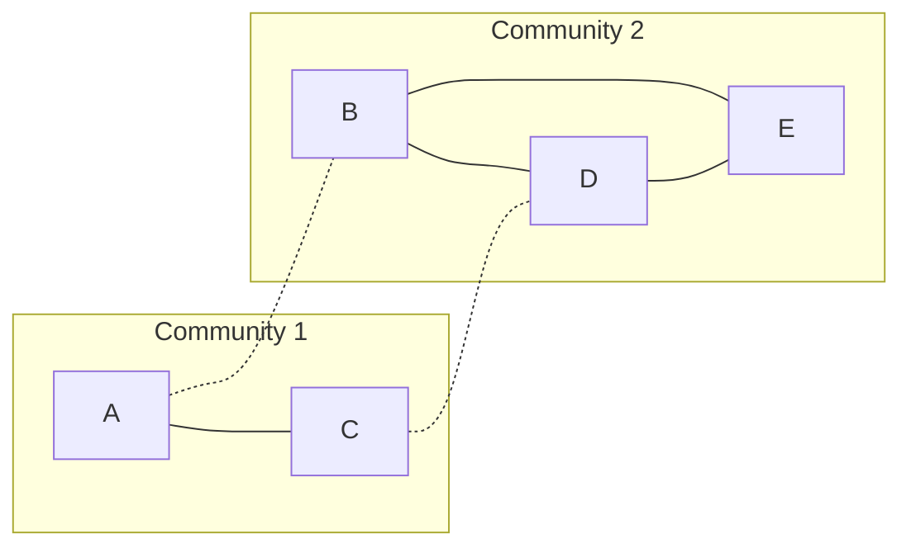

**In simple words:** Girvan-Newman algorithm un edges ko hata kar communities dhoondhta hai jo groups ke beech **bridge** ka kaam karte hain. Bridge edge bahut saare shortest paths pe hota hai, to uski **edge betweenness** zyada hoti hai. Sabse zyada betweenness wala edge baar-baar hatate hain jab tak graph alag tukdon mein na toot jaaye, aur har tukda ek community hai. <Cite id="social-network-graphs-girvan-newman2002" /> <Cite id="social-network-graphs-mmds-book" loc="§10.2" />

**Steps.**

1. Nodes ki har pair ke liye shortest paths dhoondho. Kai ho to ek unit credit unme barabar baant do.
2. Edge ki betweenness = saari pairs se mile credit ka total.
3. Sabse zyada betweenness wala edge hata do.
4. Dobara compute karo aur graph tootne tak repeat karo. <Cite id="social-network-graphs-gfg-girvan-newman" />

<Sum>

<Given>

5 nodes aur 6 edges ka undirected graph: A-B, A-C, B-D, C-D, B-E, D-E.

</Given>

<Find>

Girvan-Newman se communities.

</Find>

<Steps>

1. 10 node pairs aur unke shortest paths likho; har pair se edge ko credit 1 milta hai, do paths hon to baant dete hain. *Reason: edge betweenness ki definition yahi hai.*

| Pair | Shortest path(s) | Credit |
| --- | --- | --- |
| A-B | A-B | AB 1 |
| A-C | A-C | AC 1 |
| A-D | A-B-D and A-C-D | AB, BD, AC, CD 0.5 each |
| A-E | A-B-E | AB 1, BE 1 |
| B-C | B-A-C and B-D-C | AB, AC, BD, CD 0.5 each |
| B-D | B-D | BD 1 |
| B-E | B-E | BE 1 |
| C-D | C-D | CD 1 |
| C-E | C-D-E | CD 1, DE 1 |
| D-E | D-E | DE 1 |

2. Har edge ke credits jodo. AB = 1 + 0.5 + 1 + 0.5 = 3. AC = 1 + 0.5 + 0.5 = 2. BD = 0.5 + 0.5 + 1 = 2. CD = 0.5 + 0.5 + 1 + 1 = 3. BE = 1 + 1 = 2. DE = 1 + 1 = 2. *Reason: saari pairs ka sum.*
3. Sabse zyada value 3 hai, AB aur CD dono ki (tie). AB hata do. *Reason: dono mein se kuch bhi chuno, final split wahi aata hai; hum AB chunte hain.*
4. Bache edges AC, CD, BD, BE, DE ke liye dobara compute karo. Ab A, C se latka hai, aur B, D, E ek triangle banate hain.

| Edge | Betweenness | Why |
| --- | --- | --- |
| AC | 4 | A se C, D, B, E tak |
| CD | 6 | 2 nodes A, C se 3 nodes B, D, E tak |
| BD | 3 | B-D, A-B, C-B |
| DE | 3 | D-E, A-E, C-E |
| BE | 1 | sirf B-E |

5. Sabse zyada CD hai, 6. CD hata do. *Reason: ab wahi do groups ke beech ka akela link hai.*
6. Graph do components mein toot jaata hai: \{A, C\} aur \{B, D, E\}. *Reason: unke beech koi edge nahi bacha.*

</Steps>

<Answer>

do communities: \{A, C\} aur \{B, D, E\}. (AB ki jagah pehle CD hataane se bhi wahi result aata hai.)

</Answer>

<Box kind="verify">

Check 1: pehli betweenness values ka total $3 + 2 + 2 + 3 + 2 + 2 = 14$, jo saare shortest-path lengths ke sum ke barabar hai: $1 + 1 + 2 + 2 + 2 + 1 + 1 + 1 + 2 + 1 = 14$.

Check 2: AB hatane ke baad values ka total $4 + 6 + 3 + 3 + 1 = 17$, aur path lengths $1, 2, 3, 3, 1, 2, 2, 1, 1, 1$ ka total bhi 17.

Check 3 (modularity): $m = 6$ edges ke saath, \{A, C\} mein 1 edge aur degree total 4, aur \{B, D, E\} mein 3 edges aur degree total 8. $Q = (1/6 - (4/12)^2) + (3/6 - (8/12)^2) = 1/18 + 1/18 = 1/9 \approx 0.11$, positive, to ye split graph ko poora chhodne ($Q = 0$) se behtar hai. <Cite id="social-network-graphs-wiki-girvan-newman" />

</Box>

</Sum>

**Conclusion:** bridge edges AB aur CD sabse zyada shortest paths carry karte hain. Unhe hatane se communities \{A, C\} aur \{B, D, E\} saamne aati hain.

Exam mein English mein likho: "Girvan-Newman repeatedly removes the edge with the highest betweenness until the graph splits into communities."
