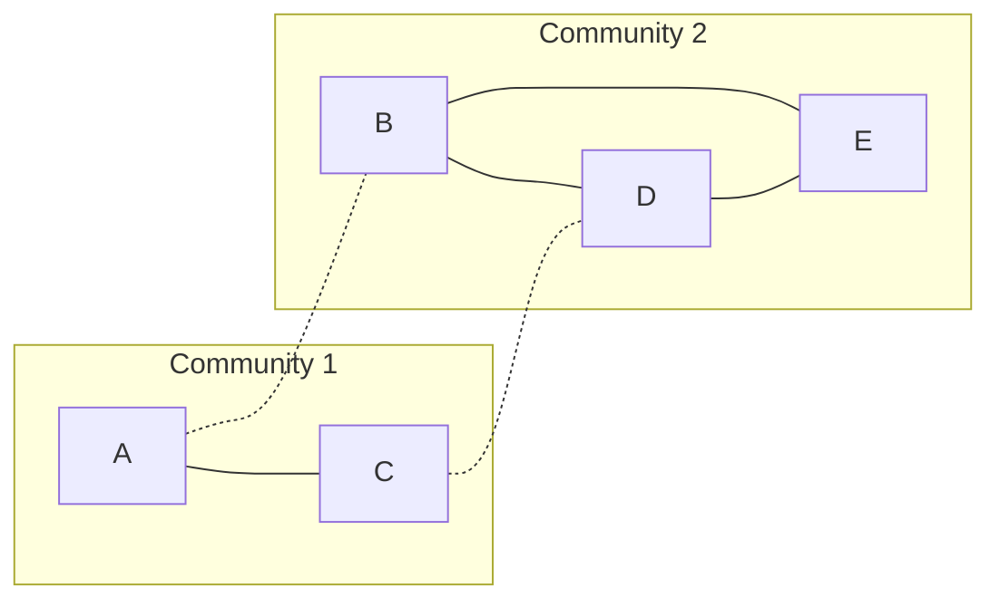

**In simple words:** the Girvan-Newman algorithm finds communities by removing the edges that act as **bridges** between groups. A bridge edge lies on many shortest paths, so it has a high **edge betweenness**. We remove the edge with the highest betweenness again and again until the graph falls into separate pieces, and each piece is a community. <Cite id="social-network-graphs-girvan-newman2002" /> <Cite id="social-network-graphs-mmds-book" loc="§10.2" />

**Steps.**

1. For every pair of nodes, find the shortest paths. If there are several, split one unit of credit equally among them.
2. The betweenness of an edge is the total credit it receives over all pairs.
3. Remove the edge with the highest betweenness.
4. Recompute and repeat until the graph splits. <Cite id="social-network-graphs-gfg-girvan-newman" />

<Sum>

<Given>

Undirected graph with 5 nodes and 6 edges: A-B, A-C, B-D, C-D, B-E, D-E.

</Given>

<Find>

the communities, using Girvan-Newman.

</Find>

<Steps>

1. List the 10 node pairs and their shortest paths; each edge gets credit 1 per pair, split if there are two paths. *Reason: this is the definition of edge betweenness.*

| Pair | Shortest path(s) | Credit |
| --- | --- | --- |
| A-B | A-B | AB 1 |
| A-C | A-C | AC 1 |
| A-D | A-B-D and A-C-D | AB, BD, AC, CD 0.5 each |
| A-E | A-B-E | AB 1, BE 1 |
| B-C | B-A-C and B-D-C | AB, AC, BD, CD 0.5 each |
| B-D | B-D | BD 1 |
| B-E | B-E | BE 1 |
| C-D | C-D | CD 1 |
| C-E | C-D-E | CD 1, DE 1 |
| D-E | D-E | DE 1 |

2. Add the credits for each edge. AB = 1 + 0.5 + 1 + 0.5 = 3. AC = 1 + 0.5 + 0.5 = 2. BD = 0.5 + 0.5 + 1 = 2. CD = 0.5 + 0.5 + 1 + 1 = 3. BE = 1 + 1 = 2. DE = 1 + 1 = 2. *Reason: sum over all pairs.*
3. The highest value is 3, shared by AB and CD (a tie). Remove AB. *Reason: either choice leads to the same final split; we pick AB.*
4. Recompute for the remaining edges AC, CD, BD, BE, DE. Now A hangs from C, and B, D, E form a triangle.

| Edge | Betweenness | Why |
| --- | --- | --- |
| AC | 4 | A to each of C, D, B, E |
| CD | 6 | the 2 nodes A, C to the 3 nodes B, D, E |
| BD | 3 | B-D, A-B, C-B |
| DE | 3 | D-E, A-E, C-E |
| BE | 1 | B-E only |

5. The highest is CD with 6. Remove CD. *Reason: it is now the only link between the two groups.*
6. The graph splits into two components: \{A, C\} and \{B, D, E\}. *Reason: no edge is left between them.*

</Steps>

<Answer>

two communities: \{A, C\} and \{B, D, E\}. (Removing CD first instead of AB gives the same result.)

</Answer>

<Box kind="verify">

Check 1: the first betweenness values add to $3 + 2 + 2 + 3 + 2 + 2 = 14$, which equals the sum of all shortest-path lengths: $1 + 1 + 2 + 2 + 2 + 1 + 1 + 1 + 2 + 1 = 14$.

Check 2: after removing AB the values add to $4 + 6 + 3 + 3 + 1 = 17$, and the path lengths are $1, 2, 3, 3, 1, 2, 2, 1, 1, 1$, which also add to 17.

Check 3 (modularity): with $m = 6$ edges, \{A, C\} has 1 edge and degree total 4, and \{B, D, E\} has 3 edges and degree total 8. $Q = (1/6 - (4/12)^2) + (3/6 - (8/12)^2) = 1/18 + 1/18 = 1/9 \approx 0.11$, positive, so the split is better than leaving the graph whole ($Q = 0$). <Cite id="social-network-graphs-wiki-girvan-newman" />

</Box>

</Sum>

**Conclusion:** the bridge edges AB and CD carry the most shortest paths. Removing them reveals the communities \{A, C\} and \{B, D, E\}.
