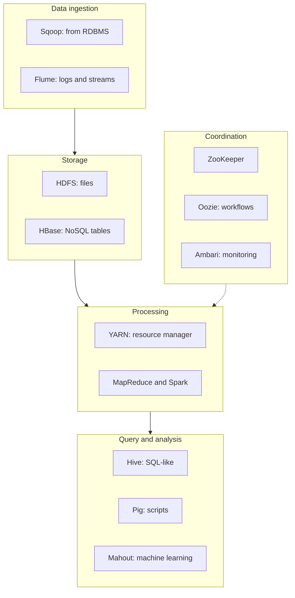

**In simple words:** **Hadoop ecosystem** un tools ka parivar hai jo Hadoop ke core (HDFS, YARN aur MapReduce) ke aaspaas bane hain. Core data store aur process karta hai, aur baaki har tool ek kami poori karta hai: loading, querying, coordination ya scheduling. <Cite id="hadoop-ecosystem-gfg-hadoop-ecosystem" /> <Cite id="hadoop-ecosystem-av-hadoop-ecosystem" />

<Cite id="hadoop-ecosystem-gfg-hadoop-ecosystem" loc="diagram" />

**Components.**

| Component | What it does, in simple words |
| --- | --- |
| **HDFS** | Bade files ko replicated blocks mein kai machines pe store karta hai. |
| **YARN** | Cluster ki CPU aur memory applications mein baantta hai. |
| **MapReduce** | Map, shuffle aur reduce steps mein batch processing. |
| **Hive** | Analysts ko HDFS data pe SQL-like queries (HiveQL) likhne deta hai. |
| **Pig** | Data-flow script language (Pig Latin) jo lambe Java code ki jagah leti hai. |
| **HBase** | HDFS pe column-oriented NoSQL database, fast single-row reads aur writes ke liye. |
| **Spark** | Fast in-memory engine, iterative kaam, machine learning aur streaming ke liye. |
| **Mahout** | Recommendation aur clustering jaise scalable machine-learning algorithms. |
| **ZooKeeper** | Configuration, naming, locks aur leader election ki central service. |
| **Oozie** | Jobs ki chain (workflow) schedule karta hai. |
| **Sqoop** | Relational databases aur HDFS ke beech bulk copy. |
| **Flume** | Logs jaisa streaming data HDFS mein collect karta hai. |
| **Ambari** | Cluster set up aur monitor karne ka web tool. |

<Cite id="hadoop-ecosystem-apache-hive" /> <Cite id="hadoop-ecosystem-apache-hbase" /> <Cite id="hadoop-ecosystem-apache-spark" />

**Example flow.** Sqoop customer tables aur Flume web logs ko HDFS mein laata hai; Hive ya Pig YARN se unhe clean aur summarise karta hai; Spark model train karta hai; Oozie poori chain roz raat ko chalata hai.

**Conclusion:** core storage aur processing deta hai, aur ecosystem tools loading, querying, analysis aur management jodte hain, taaki ek cluster pe poori big-data pipeline chal sake. Kuch tools (jaise Sqoop) ab Apache ne retire kar diye hain. <Cite id="hadoop-ecosystem-apache-hadoop" />

Exam mein English mein likho: "The Hadoop ecosystem has HDFS, YARN and MapReduce at the core, with Hive, Pig, HBase, Spark, ZooKeeper, Oozie, Sqoop and Flume around it."
