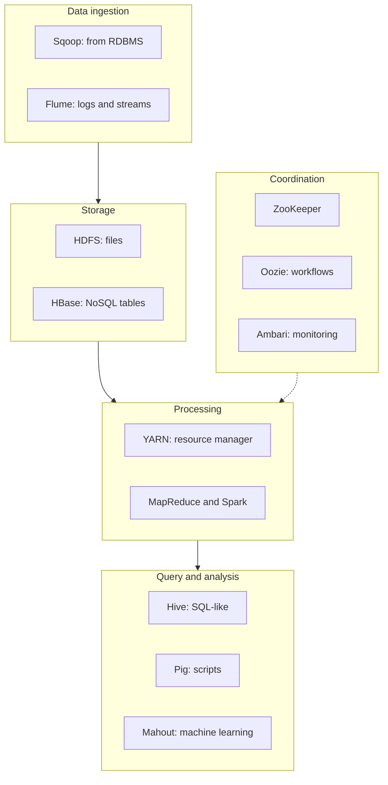

**In simple words:** the **Hadoop ecosystem** is the family of tools built around Hadoop's core (HDFS, YARN and MapReduce). The core stores and processes data, and each other tool fills one gap: loading, querying, coordination or scheduling. <Cite id="hadoop-ecosystem-gfg-hadoop-ecosystem" /> <Cite id="hadoop-ecosystem-av-hadoop-ecosystem" />

<Cite id="hadoop-ecosystem-gfg-hadoop-ecosystem" loc="diagram" />

**The components.**

| Component | What it does, in simple words |
| --- | --- |
| **HDFS** | Stores big files as replicated blocks over many machines. |
| **YARN** | Shares the cluster's CPU and memory among applications. |
| **MapReduce** | Batch processing in map, shuffle and reduce steps. |
| **Hive** | Lets analysts write SQL-like queries (HiveQL) on HDFS data. |
| **Pig** | A data-flow script language (Pig Latin) that replaces long Java code. |
| **HBase** | A column-oriented NoSQL database on HDFS for fast single-row reads and writes. |
| **Spark** | A fast in-memory engine for iterative work, machine learning and streaming. |
| **Mahout** | Scalable machine-learning algorithms such as recommendation and clustering. |
| **ZooKeeper** | Central service for configuration, naming, locks and leader election. |
| **Oozie** | Schedules a chain of jobs (a workflow). |
| **Sqoop** | Bulk copy between relational databases and HDFS. |
| **Flume** | Collects streaming data such as logs into HDFS. |
| **Ambari** | Web tool to set up and monitor the cluster. |

<Cite id="hadoop-ecosystem-apache-hive" /> <Cite id="hadoop-ecosystem-apache-hbase" /> <Cite id="hadoop-ecosystem-apache-spark" />

**Example flow.** Sqoop loads customer tables and Flume loads web logs into HDFS; Hive or Pig cleans and summarises them using YARN; Spark trains a model; Oozie runs the whole chain every night.

**Conclusion:** the core gives storage and processing, and the ecosystem tools add loading, querying, analysis and management, so that a complete big-data pipeline can run on one cluster. Some tools (for example Sqoop) have since been retired by Apache. <Cite id="hadoop-ecosystem-apache-hadoop" />
