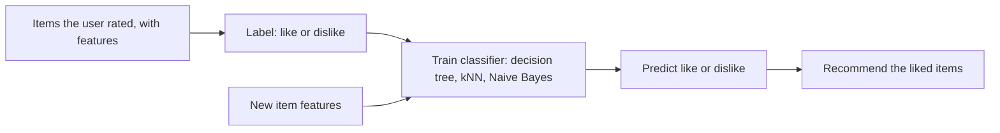

**In simple words:** **recommendation system** (recommender) predict karta hai ki user ko kya pasand aayega aur use suggest karta hai, jaise Netflix pe movies ya Amazon pe products. Ye users ko bade catalogue mein items dhoondhne mein madad karta hai aur sellers ko zyada bechne mein, kam popular items (long tail) bhi. <Cite id="recommendation-systems-wiki-recsys" /> <Cite id="recommendation-systems-mmds-book" loc="§9.1" />

**Basic model.** Data ek **utility matrix** hai: rows users, columns items, aur cell mein user ki di hui rating. Zyadatar cells khaali hote hain, aur system ko unhe predict karna hota hai.

| | Movie 1 | Movie 2 | Movie 3 |
| --- | --- | --- | --- |
| User A | 5 | 4 | ? |
| User B | 1 | ? | 5 |

**Types.** Content-based (item features ko user ki pasand se match karo), collaborative filtering (milte-julte users ya items ki ratings use karo) aur hybrid (dono mix). <Cite id="recommendation-systems-av" />

**Classification kaise use hota hai (content-based method).** Har user ke liye recommendation ko classification problem maante hain. <Cite id="recommendation-systems-gfg-cb" /> <Cite id="recommendation-systems-ibm" />

1. **Item features banao.** Har item ko features se describe karo, jaise movie ko genre, director aur actors se.
2. **Training data banao.** Ek user ke liye, jin items ko usne rate kiya wahi examples hain. Features input hain, aur label "like" (high rating) ya "dislike" (low rating) hai.
3. Us user ke liye **classifier train karo**. Common choices: decision tree, k-nearest neighbours, Naive Bayes ya logistic regression.
4. **Predict karo.** Unseen item ke features classifier ko do. Wo like ya dislike deta hai.
5. "Like" predict hue items **recommend karo**, classifier ke confidence ke hisaab se rank karke.

**Example.** User A ne 3 comedy films pasand ki aur 2 horror films nahi. Decision tree seekhta hai "genre = comedy → like". Nayi comedy film like classify hoti hai aur recommend ki jaati hai.

| Advantage | Limitation |
| --- | --- |
| Doosre users ki zaroorat nahi, to unique taste wale user ke liye bhi kaam karta hai | Har user ke liye kaafi rated examples chahiye (cold start) |
| Nayi items ko recommend kar sakta hai jinke features hain | Sirf wahi items recommend karta hai jo user ki pasand jaise hon |
| Kyun dikhaya, ye samjhana aasaan | Achhe item features chahiye |

**Conclusion:** recommender missing ratings predict karta hai; classification ye item features pe har user ke liye like ya dislike classifier train karke karta hai. <Cite id="recommendation-systems-mmds-book" loc="§9.2" />

Exam mein English mein likho: "In content-based recommendation, a classifier is trained for each user on item features to predict like or dislike."
