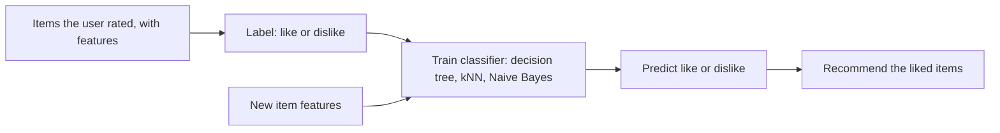

**In simple words:** a **recommendation system** (recommender) predicts what a user will like and suggests it, such as movies on Netflix or products on Amazon. It helps users find items in a huge catalogue and helps sellers sell more, including the less popular items (the long tail). <Cite id="recommendation-systems-wiki-recsys" /> <Cite id="recommendation-systems-mmds-book" loc="§9.1" />

**Basic model.** The data is a **utility matrix**: rows are users, columns are items, and a cell holds the rating the user gave. Most cells are empty, and the system must predict them.

| | Movie 1 | Movie 2 | Movie 3 |
| --- | --- | --- | --- |
| User A | 5 | 4 | ? |
| User B | 1 | ? | 5 |

**Types.** Content-based (match item features to the user's taste), collaborative filtering (use ratings of similar users or items) and hybrid (mix both). <Cite id="recommendation-systems-av" />

**How classification is used (content-based method).** Recommendation is treated as a classification problem for each user. <Cite id="recommendation-systems-gfg-cb" /> <Cite id="recommendation-systems-ibm" />

1. **Build item features.** Describe each item by features, for example a movie by genre, director and actors.
2. **Make training data.** For one user, the items they rated are the examples. The features are the input, and the label is "like" (high rating) or "dislike" (low rating).
3. **Train a classifier** for that user. Common choices are a decision tree, k-nearest neighbours, Naive Bayes or logistic regression.
4. **Predict.** Give the features of an unseen item to the classifier. It returns like or dislike.
5. **Recommend** the items predicted as "like", ranked by the classifier's confidence.

**Example.** User A liked 3 comedy films and disliked 2 horror films. A decision tree learns "genre = comedy → like". A new comedy film is classified as like and recommended.

| Advantage | Limitation |
| --- | --- |
| Needs no other users, so it works for a user with unique taste | Needs enough rated examples for each user (cold start) |
| Can recommend new items that have features | Only recommends items similar to what the user already liked |
| Easy to explain why an item was shown | Needs good item features |

**Conclusion:** a recommender predicts missing ratings; classification does this by training a per-user like or dislike classifier on item features. <Cite id="recommendation-systems-mmds-book" loc="§9.2" />
