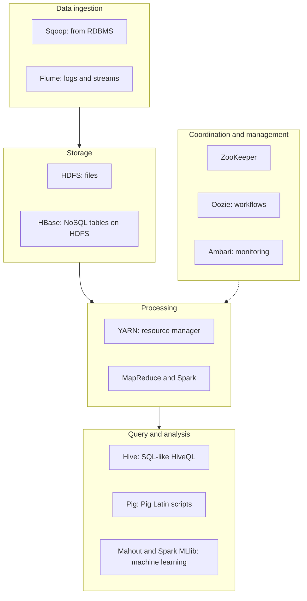

**In simple words:** Hadoop ecosystem un tools ka parivaar hai jo Hadoop core (HDFS, YARN, MapReduce) ke aas-paas bane hain. Core data store aur process karta hai, lekin real projects mein loading, querying, coordination aur scheduling bhi chahiye. Har tool ek aisi kami poori karta hai. <Cite id="hadoop-ecosystem-gfg-hadoop-ecosystem" /> <Cite id="hadoop-ecosystem-av-hadoop-ecosystem" />

<Cite id="hadoop-ecosystem-gfg-hadoop-ecosystem" loc="diagram" />

| Component | Kaam, simple words mein |
|---|---|
| **HDFS** | Bade files ko replicated blocks mein cluster pe store karta hai (NameNode map rakhta hai, DataNodes blocks). |
| **YARN** | Cluster ki CPU aur memory applications mein baantta hai. |
| **MapReduce** | Map, shuffle aur reduce steps mein batch processing. |
| **Hive** | HDFS ke data pe SQL jaisi queries (HiveQL); ye distributed jobs mein badal jaati hain. Analysts ke liye. |
| **Pig** | Lambe Java ki jagah Pig Latin mein data-flow scripts (load, filter, group, join). |
| **HBase** | HDFS pe column-oriented NoSQL database, single rows ko fast read aur write karne ke liye. |
| **Spark** | Fast in-memory engine, iterative jobs, machine learning aur streaming ke liye. |
| **Mahout** | Scalable machine-learning algorithms (recommendation, clustering, classification). |
| **ZooKeeper** | Configuration, naming, locks aur leader election ke liye coordination service. |
| **Oozie** | Jobs ki chain (workflow) ko sahi order aur time pe chalata hai. |
| **Sqoop** | Relational databases aur HDFS ke beech bulk copy. |
| **Flume** | Server logs jaisa streaming data HDFS mein laata hai. |
| **Ambari** | Cluster setup aur monitor karne ka web tool. |

<Cite id="hadoop-ecosystem-apache-hive" /> <Cite id="hadoop-ecosystem-apache-hbase" /> <Cite id="hadoop-ecosystem-apache-hadoop" />

**Example flow:** Sqoop MySQL se sales data HDFS mein laata hai, Hive us pe SQL query chalata hai, Oozie ise har raat repeat karta hai, aur ZooKeeper services ko aapas mein sahmat rakhta hai.

**Conclusion:** core storage aur batch processing deta hai; ecosystem ingestion, SQL access, fast lookup, machine learning aur scheduling jodta hai. Kuch tools (jaise Sqoop) ab retire ya replace ho gaye hain, lekin exam mein classic list hi poochhi jaati hai.
