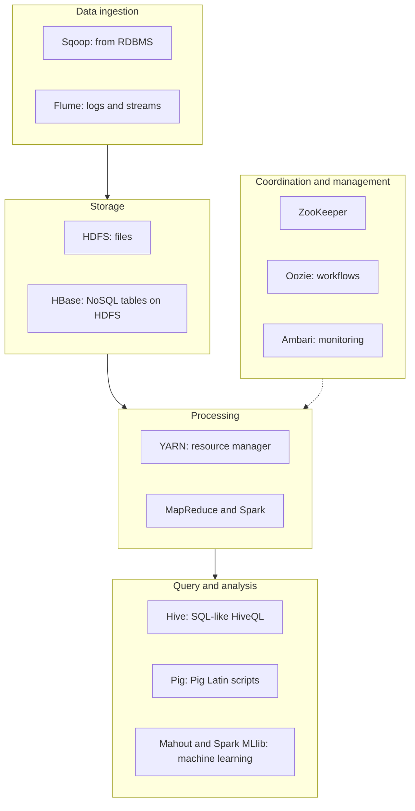

**In simple words:** the Hadoop ecosystem is the family of tools built around the Hadoop core (HDFS, YARN, MapReduce). The core stores and processes data, but real projects also need loading, querying, coordination and scheduling. Each tool fills one such gap. <Cite id="hadoop-ecosystem-gfg-hadoop-ecosystem" /> <Cite id="hadoop-ecosystem-av-hadoop-ecosystem" />

<Cite id="hadoop-ecosystem-gfg-hadoop-ecosystem" loc="diagram" />

| Component | Job, in simple words |
|---|---|
| **HDFS** | Stores big files as replicated blocks across the cluster (NameNode keeps the map, DataNodes keep the blocks). |
| **YARN** | Shares the cluster's CPU and memory between applications. |
| **MapReduce** | Batch processing in map, shuffle and reduce steps. |
| **Hive** | SQL-like queries (HiveQL) on data in HDFS; turned into distributed jobs. For analysts. |
| **Pig** | Data-flow scripts in Pig Latin (load, filter, group, join) instead of long Java. |
| **HBase** | Column-oriented NoSQL database on HDFS for fast random read and write of single rows. |
| **Spark** | Fast in-memory engine for iterative jobs, machine learning and streaming. |
| **Mahout** | Scalable machine-learning algorithms (recommendation, clustering, classification). |
| **ZooKeeper** | Coordination service for configuration, naming, locks and leader election. |
| **Oozie** | Runs a chain of jobs (a workflow) in order and on schedule. |
| **Sqoop** | Bulk copy between relational databases and HDFS. |
| **Flume** | Collects streaming data such as server logs into HDFS. |
| **Ambari** | Web tool to set up and monitor the cluster. |

<Cite id="hadoop-ecosystem-apache-hive" /> <Cite id="hadoop-ecosystem-apache-hbase" /> <Cite id="hadoop-ecosystem-apache-hadoop" />

**Example flow:** Sqoop loads sales data from MySQL into HDFS, Hive runs a SQL query on it, Oozie repeats this every night, and ZooKeeper keeps the services in agreement.

**Conclusion:** the core gives storage and batch processing; the ecosystem adds ingestion, SQL access, fast lookup, machine learning and scheduling. Some tools (Sqoop for example) are now retired or replaced, but the classic list is what the exam asks.
