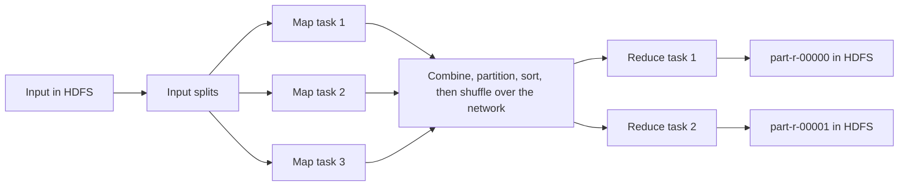

**In simple words:** MapReduce cluster pe bade data ko parallel process karta hai. Programmer sirf do functions likhta hai, **Map** aur **Reduce**; framework input ko split karta hai, tasks ko data ke paas chalata hai, pairs ko key se group karta hai aur failures se recover karta hai. <Cite id="hadoop-ecosystem-dean2004" /> <Cite id="hadoop-ecosystem-mmds" loc="§2.2" />

**Components ke functions**

| Component | Function |
|---|---|
| Client | Code package karta hai, input aur output paths batata hai, job submit karta hai. |
| Resource manager (YARN) | Cluster resources deta hai aur free nodes dhoondta hai, data ke paas wale pehle. |
| Job master (MRAppMaster) | Map aur reduce tasks banata hai, assign karta hai, progress track karta hai, fail hue tasks dobara chalata hai. |
| Workers (NodeManager) | Tasks chalate hain aur heartbeats bhejte hain. |
| InputSplit, RecordReader | Input ko splits mein kaatte hain aur har split ko (key, value) records banate hain. |
| Mapper | Har record pe map function chalata hai aur (key, value) pairs emit karta hai. |
| Combiner (optional) | Map output pe mini reduce, taaki kam data bheje. |
| Partitioner | Har key ke liye reducer chunta hai, `hash(key) mod R`. |
| Shuffle and sort | Har reducer apna hissa saare mappers se copy karta hai aur key ke hisaab se merge karta hai. |
| Reducer | Har key aur uski values ki list pe reduce function chalata hai. |
| OutputFormat, HDFS | Result likhte hain, har reducer ki ek file. |

<Cite id="hadoop-ecosystem-apache-yarn" /> <Cite id="mapreduce-gfg-mr" />

**Execution steps**

1. **Submit:** client job code aur settings cluster ko bhejta hai.
2. **Split:** input splits mein kata jaata hai, har split ke liye ek map task.
3. **Schedule:** job master map tasks start karta hai, un nodes ko prefer karta hai jinke paas block hai (data locality).
4. **Map:** har task har record pe map call karta hai; output buffer hota hai, sort aur partition hota hai, phir local disk pe spill hota hai.
5. **Shuffle:** har reducer apna hissa saare mappers se network pe copy karta hai.
6. **Sort and merge:** har reducer apne hisson ko sorted key groups mein merge karta hai.
7. **Reduce:** reduce function har key pe ek baar chalta hai aur HDFS mein likhta hai.
8. **Finish:** master success report karta hai aur output files ready hoti hain.

<Cite id="mapreduce-gfg-mr" loc="diagram" /> <Cite id="mapreduce-tpoint" loc="diagram" />

**Example (word count):** map `deer bear deer` ko (deer,1) (bear,1) (deer,1) banata hai; shuffle unhe bear: [1] aur deer: [1,1] mein group karta hai; reduce har list ko jodta hai to (bear,1) aur (deer,2) milta hai.

**Conclusion:** user map aur reduce likhta hai; framework splitting, locality, shuffling aur failure recovery karta hai. Reduce sab maps ke khatam hone ke baad hi start hota hai, kyunki ek key abhi chal rahe map se aa sakti hai.
