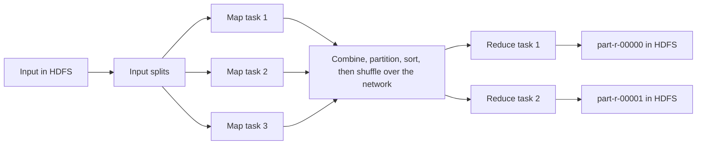

**In simple words:** MapReduce processes huge data in parallel on a cluster. The programmer writes only two functions, **Map** and **Reduce**; the framework splits the input, runs tasks near the data, groups pairs by key and recovers from failures. <Cite id="hadoop-ecosystem-dean2004" /> <Cite id="hadoop-ecosystem-mmds" loc="§2.2" />

**Functions of the components**

| Component | Function |
|---|---|
| Client | Packages the code, names input and output paths, submits the job. |
| Resource manager (YARN) | Gives out cluster resources and finds free nodes, preferably near the data. |
| Job master (MRAppMaster) | Creates map and reduce tasks, assigns them, tracks progress, restarts failed tasks. |
| Workers (NodeManager) | Run the tasks and send heartbeats. |
| InputSplit, RecordReader | Cut the input into splits and turn each into (key, value) records. |
| Mapper | Runs the map function on each record and emits (key, value) pairs. |
| Combiner (optional) | Mini reduce on the map output to shrink the data sent. |
| Partitioner | Picks the reducer for each key, `hash(key) mod R`. |
| Shuffle and sort | Copies each reducer's pairs from all mappers and merges them by key. |
| Reducer | Runs the reduce function on each key and its list of values. |
| OutputFormat, HDFS | Write the result, one file per reducer. |

<Cite id="hadoop-ecosystem-apache-yarn" /> <Cite id="mapreduce-gfg-mr" />

**Execution steps**

1. **Submit:** the client sends the job code and settings to the cluster.
2. **Split:** the input is cut into splits, one map task per split.
3. **Schedule:** the job master starts map tasks, preferring nodes that hold the block (data locality).
4. **Map:** each task calls map on every record; output is buffered, sorted, partitioned and spilled to local disk.
5. **Shuffle:** every reducer copies its part from all mappers over the network.
6. **Sort and merge:** each reducer merges its parts into sorted key groups.
7. **Reduce:** the reduce function runs once per key and writes to HDFS.
8. **Finish:** the master reports success and the output files are ready.

<Cite id="mapreduce-gfg-mr" loc="diagram" /> <Cite id="mapreduce-tpoint" loc="diagram" />

**Example (word count):** map turns `deer bear deer` into (deer,1) (bear,1) (deer,1); the shuffle groups them as bear: [1] and deer: [1,1]; reduce adds each list to give (bear,1) and (deer,2).

**Conclusion:** the user writes map and reduce; the framework does splitting, locality, shuffling and failure recovery. Reduce starts only after all maps finish, because a key may still come from a running map.
