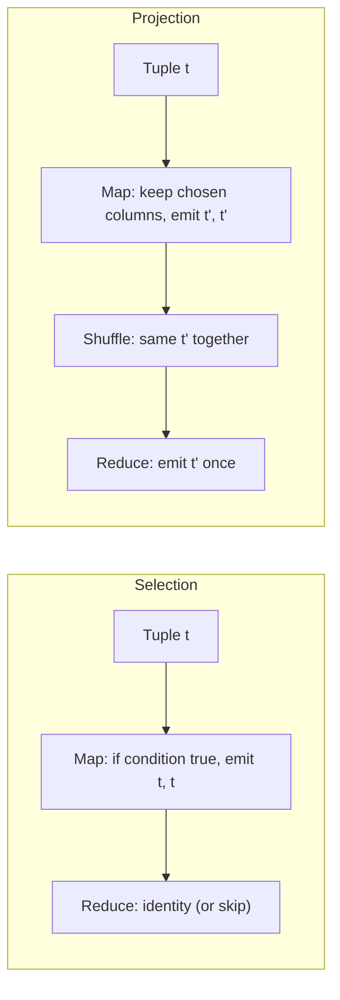

**In simple words:** relation tuples (rows) ka ek table hai. **Selection** sirf wahi rows rakhta hai jo condition satisfy karti hain. **Projection** sirf kuch columns rakhta hai aur isse bane duplicate rows hata deta hai. Dono MapReduce pe aasaani se fit hote hain, jahan tuple khud key hota hai. <Cite id="hadoop-ecosystem-mmds" /> <Cite id="mapreduce-algorithms-gfg-relalg" />

**Selection $\sigma_C(R)$.** Har tuple $t$ ke liye, **Map** condition $C$ test karta hai: true ho to $(t, t)$ emit karta hai, warna kuch nahi. **Reduce** identity hai (bas value likh deta hai), isliye selection map-only job ho sakta hai. Har tuple akele judge hota hai, to tuples ko ek dusre se milne ki zarurat nahi.

**Projection $\pi_S(R)$.** **Map** $t$ se $t'$ banata hai jisme sirf $S$ ke columns hote hain aur $(t', t')$ emit karta hai. Columns hatane ke baad do alag rows barabar ho sakti hain, aur relation mein duplicates nahi hote, isliye **Reduce** ko $(t', [t', t', \ldots])$ milta hai aur wo $t'$ ek hi baar emit karta hai. Combiner bhi map side pe duplicates hata sakta hai.

<Cite id="mapreduce-algorithms-gfg-relalg" loc="diagram" />

<Sum>

<Given>

Relation $R(Id, Name, Dept)$ jisme 5 tuples hain: (1, Asha, CSE), (2, Ravi, IT), (3, Meena, CSE), (4, Kiran, IT), (5, Sara, ECE).

</Given>

<Find>

$\sigma_{Dept = CSE}(R)$ aur $\pi_{Dept}(R)$.

</Find>

<Steps>

1. **Selection map.** Har tuple pe Dept = CSE test karo:

   | Tuple | Dept = CSE? | Map output |
   |---|---|---|
   | (1, Asha, CSE) | yes | ((1,Asha,CSE), (1,Asha,CSE)) |
   | (2, Ravi, IT) | no | nothing |
   | (3, Meena, CSE) | yes | ((3,Meena,CSE), (3,Meena,CSE)) |
   | (4, Kiran, IT) | no | nothing |
   | (5, Sara, ECE) | no | nothing |

2. **Selection reduce.** Identity: har key ek baar likho. *Reason: har tuple ek hi baar aata hai, to kuch merge nahi hota.*
3. **Projection map.** Sirf Dept rakho: (CSE,CSE), (IT,IT), (CSE,CSE), (IT,IT), (ECE,ECE).
4. **Projection shuffle.** CSE: [CSE, CSE]; IT: [IT, IT]; ECE: [ECE].
5. **Projection reduce.** Har key ek baar emit karo. *Reason: isse duplicates hat jaate hain.*

</Steps>

<Answer>

$\sigma_{Dept = CSE}(R) = \{(1, Asha, CSE), (3, Meena, CSE)\}$ aur $\pi_{Dept}(R) = \{CSE, IT, ECE\}$.

</Answer>

<Box kind="verify">

Selection: $R$ ki do rows ka Dept CSE hai (Id 1 aur 3) aur dono answer mein hain, koi chhooti nahi. Projection: 5 input rows se 3 distinct values bani, aur $2 + 2 + 1 = 5$ rows ginti mein aa gayi (CSE do baar, IT do baar, ECE ek baar).

</Box>

</Sum>

**Conclusion:** selection map-only filter hai; projection ko duplicates hatane ke liye map aur reduce dono chahiye. Dono mein poora tuple key hota hai.
