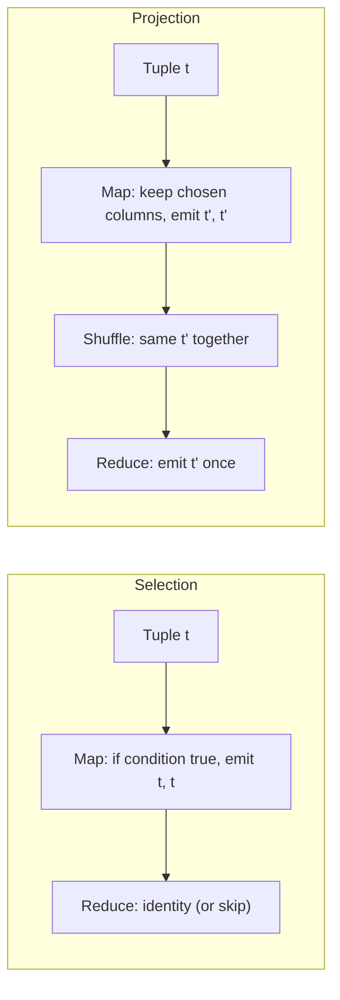

**In simple words:** a relation is a table of tuples (rows). **Selection** keeps only the rows that satisfy a condition. **Projection** keeps only some columns and removes the duplicate rows this creates. Both map neatly onto MapReduce, with the tuple itself used as the key. <Cite id="hadoop-ecosystem-mmds" /> <Cite id="mapreduce-algorithms-gfg-relalg" />

**Selection $\sigma_C(R)$.** For each tuple $t$, **Map** tests the condition $C$: if true it emits $(t, t)$, otherwise nothing. **Reduce** is the identity (it just writes the value), so selection can be a map-only job. Every tuple is judged on its own, so no tuples need to meet.

**Projection $\pi_S(R)$.** **Map** builds $t'$ from $t$ by keeping only the columns in $S$ and emits $(t', t')$. After dropping columns two different rows can become equal, and a relation has no duplicates, so **Reduce** receives $(t', [t', t', \ldots])$ and emits $t'$ once. A combiner can also remove duplicates on the map side.

<Cite id="mapreduce-algorithms-gfg-relalg" loc="diagram" />

<Sum>

<Given>

Relation $R(Id, Name, Dept)$ with 5 tuples: (1, Asha, CSE), (2, Ravi, IT), (3, Meena, CSE), (4, Kiran, IT), (5, Sara, ECE).

</Given>

<Find>

$\sigma_{Dept = CSE}(R)$ and $\pi_{Dept}(R)$.

</Find>

<Steps>

1. **Selection map.** Test Dept = CSE on each tuple:

   | Tuple | Dept = CSE? | Map output |
   |---|---|---|
   | (1, Asha, CSE) | yes | ((1,Asha,CSE), (1,Asha,CSE)) |
   | (2, Ravi, IT) | no | nothing |
   | (3, Meena, CSE) | yes | ((3,Meena,CSE), (3,Meena,CSE)) |
   | (4, Kiran, IT) | no | nothing |
   | (5, Sara, ECE) | no | nothing |

2. **Selection reduce.** Identity: write each key once. *Reason: each tuple occurs once, so nothing is merged.*
3. **Projection map.** Keep only Dept: (CSE,CSE), (IT,IT), (CSE,CSE), (IT,IT), (ECE,ECE).
4. **Projection shuffle.** CSE: [CSE, CSE]; IT: [IT, IT]; ECE: [ECE].
5. **Projection reduce.** Emit each key once. *Reason: this removes the duplicates.*

</Steps>

<Answer>

$\sigma_{Dept = CSE}(R) = \{(1, Asha, CSE), (3, Meena, CSE)\}$ and $\pi_{Dept}(R) = \{CSE, IT, ECE\}$.

</Answer>

<Box kind="verify">

Selection: two rows of $R$ have Dept CSE (Ids 1 and 3) and both are in the answer, none missed. Projection: 5 input rows give 3 distinct values, and $2 + 2 + 1 = 5$ rows are accounted for (CSE twice, IT twice, ECE once).

</Box>

</Sum>

**Conclusion:** selection is a map-only filter; projection needs map plus reduce to remove duplicates. Both use the whole tuple as the key.
