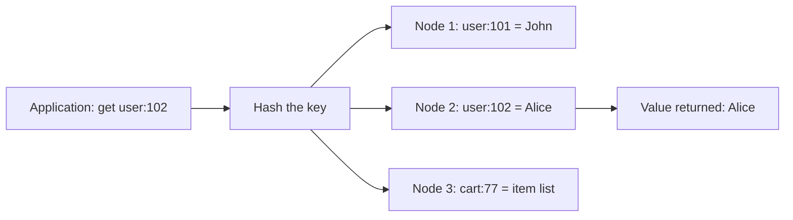
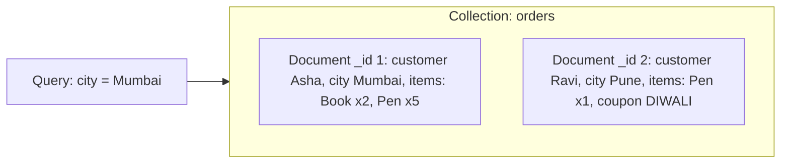

**In simple words:** architectural pattern wo basic tareeka hai jisse NoSQL database apna data organise karta hai. Key-value store sabse simple hai: ek bada dictionary. Document store poore JSON documents rakhta hai jinke andar database dekh sakta hai. <Cite id="big-data-intro-nosql" /> <Cite id="nosql-patterns-gfg-types" />

**1. Key-value store.** Har item ki ek unique **key** aur ek **value** hoti hai. Database key ko hash karke node dhoondta hai aur value ko ek block ki tarah lauta deta hai; andar kabhi nahi dekhta. Operations sirf `put(key, value)`, `get(key)` aur `delete(key)` hain. Analogy: cloakroom ka token aapka bag bina kholey wapas dilata hai. <Cite id="nosql-patterns-gfg-kv" /> <Cite id="nosql-patterns-redis-kv" />



<Cite id="nosql-patterns-gfg-kv" loc="diagram" />

| Key | Value |
|---|---|
| `session:8f3a` | `{user: 101, login: "10:42"}` |
| `cart:77` | `[book-12, pen-3]` |

Kahan kaam aata hai: sessions, shopping carts, caches, leaderboards. Examples: Redis, DynamoDB, Riak. Benefits: bahut fast, scale out aasaan, schema nahi. Limits: sirf key se search, joins nahi, poori value saath padhi aur likhi jaati hai.

**2. Document store.** Har record ek **document** hota hai, aam taur pe JSON, jisme apne field names, nested fields aur lists hoti hain. Documents ek **collection** mein hote hain, lekin unke fields same hone zaroori nahi. Database andar dekh sakta hai, isliye kisi bhi field se query aur update ho sakta hai. <Cite id="nosql-patterns-gfg-doc" /> <Cite id="nosql-patterns-mongo-doc" />



<Cite id="nosql-patterns-gfg-doc" loc="diagram" />

```json
{ "_id": 1, "customer": { "name": "Asha", "city": "Mumbai" },
  "items": [ { "product": "Book", "qty": 2 }, { "product": "Pen", "qty": 5 } ] }
```

Kahan kaam aata hai: product catalogues, user profiles, content management. Examples: MongoDB, CouchDB. Benefits: code ke objects se match karta hai, aam reads mein joins nahi, schema flexible. Limits: repeated data har jagah update karna padta hai, aur joins aur multi-document transactions kamzor hain.

| Point | Key-value | Document |
|---|---|---|
| Value | Opaque blob | Structured JSON jo database samajhta hai |
| Query | Sirf key se | Key se aur kisi bhi field se |
| Update | Poori value badlo | Ek field update karo |

**Conclusion:** key se sabse fast simple lookup ke liye key-value, aur jab records rich hon aur unke fields se search karna ho tab document store use karo.
