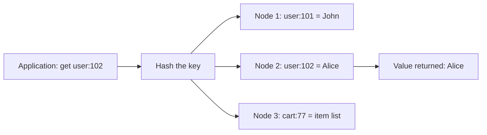
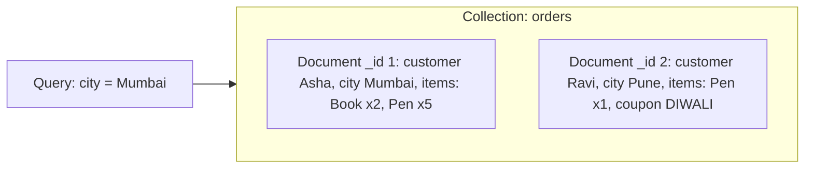

**In simple words:** an architectural pattern is the basic way a NoSQL database organises its data. The key-value store is the simplest: a giant dictionary. The document store keeps whole JSON documents that the database can look inside. <Cite id="big-data-intro-nosql" /> <Cite id="nosql-patterns-gfg-types" />

**1. Key-value store.** Every item has a unique **key** and a **value**. The database hashes the key to find the node and returns the value as one block; it never looks inside. Operations are only `put(key, value)`, `get(key)` and `delete(key)`. Analogy: a cloakroom token gives back your bag without anyone opening it. <Cite id="nosql-patterns-gfg-kv" /> <Cite id="nosql-patterns-redis-kv" />



<Cite id="nosql-patterns-gfg-kv" loc="diagram" />

| Key | Value |
|---|---|
| `session:8f3a` | `{user: 101, login: "10:42"}` |
| `cart:77` | `[book-12, pen-3]` |

Good for: sessions, shopping carts, caches, leaderboards. Examples: Redis, DynamoDB, Riak. Benefits: very fast, easy to scale out, no schema. Limits: search only by key, no joins, the whole value is read and written together.

**2. Document store.** Each record is a **document**, usually JSON, with its own field names, nested fields and lists. Documents are grouped in a **collection**, but they need not have the same fields. The database can look inside, so you can query and update by any field. <Cite id="nosql-patterns-gfg-doc" /> <Cite id="nosql-patterns-mongo-doc" />



<Cite id="nosql-patterns-gfg-doc" loc="diagram" />

```json
{ "_id": 1, "customer": { "name": "Asha", "city": "Mumbai" },
  "items": [ { "product": "Book", "qty": 2 }, { "product": "Pen", "qty": 5 } ] }
```

Good for: product catalogues, user profiles, content management. Examples: MongoDB, CouchDB. Benefits: matches objects in code, no joins for common reads, flexible schema. Limits: repeated data must be updated everywhere, and joins and multi-document transactions are weak.

| Point | Key-value | Document |
|---|---|---|
| Value | Opaque blob | Structured JSON the database understands |
| Query | Only by key | By key and by any field |
| Update | Replace the whole value | Update one field |

**Conclusion:** use key-value for the fastest simple lookup by key, and a document store when records are rich and must be searched by their fields.
