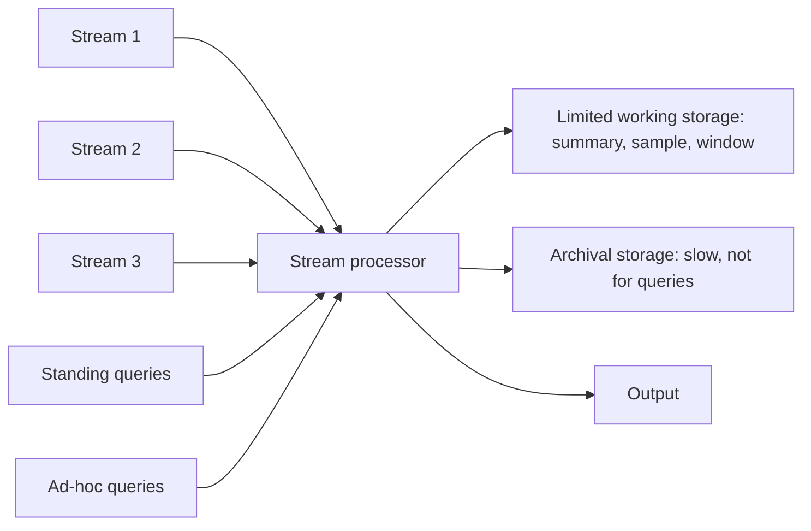

**In simple words:** data stream elements ki ek sequence hai jo lagatar aati rehti hai, itni tez ki hum sab store nahi kar sakte (sensor readings, clicks, stock ticks). **Data Stream Management System (DSMS)** streams ko leta hai aur data ke guzarte hue hi uske baare mein sawalon ke jawab deta hai, sirf thodi si memory use karke. Ye DBMS jaisa dikhta hai lekin streams ke liye bana hai. <Cite id="stream-data-model-wiki-dsms" /> <Cite id="stream-data-model-babcock2002" />

**DBMS kaafi kyun nahi:** DBMS pehle data store karta hai aur baad mein query karta hai, aur use poora data set chahiye. Stream anant hai, tez hai aur sirf ek baar dikhti hai, isliye system ko ek chhote summary se jawab dena padta hai.

<Cite id="stream-data-model-cs246-slides" loc="slide 7" /> <Cite id="stream-data-model-gfg-dbms-dsms" />

**Kaise kaam karta hai**

1. **Streams** ek saath processor mein aati hain. Har stream elements ki sequence hai, jaise (sensor id, time, temperature).
2. **Standing queries** system mein stored rehti hain aur har naye element pe chalti hain, jab bhi report karne layak kuch ho output deti hain. Example: ab tak ka sabse high temperature batao.
3. **Ad-hoc queries** ek baar poochhi jaati hain, user ke chune hue time pe. Example: pichhle 10 minute mein kitne users login hue. Ye sirf working storage ka data use kar sakti hain.
4. **Limited working storage** (main memory, kabhi disk) summary, sample ya recent elements ki window rakhta hai, poori stream kabhi nahi.
5. **Archival storage** (warehouse ya tape) poori stream baad ke offline analysis ke liye rakhta hai. Ye queries ka jawab dene ke liye bahut slow hai.
6. **Output** jawab ko alert, report ya kisi dusre system ke feed ki tarah deta hai.

Andar system mein input buffer, scheduler (jo agla operator chunta hai), query processor aur storage manager hote hain. Overload mein kuch elements gira bhi sakta hai (load shedding). <Cite id="stream-data-model-geisler" />

| Point | DBMS | DSMS |
|---|---|---|
| Data | Stored, finite | Lagatar aata hai, unbounded |
| Queries | One-time | Standing (continuous) aur ad-hoc |
| Memory | Disk, bada | Chhoti main memory |
| Answers | Exact | Aksar approximate |

**Applications:** sensor networks, stock-market feeds, network traffic monitoring, web click analysis.

**Conclusion:** DSMS har element ek hi baar padhta hai, sirf chhota summary rakhta hai, standing queries hamesha chalata hai, aur poori stream ko archive mein bhej deta hai jo live sawalon ka jawab nahi de sakta.
