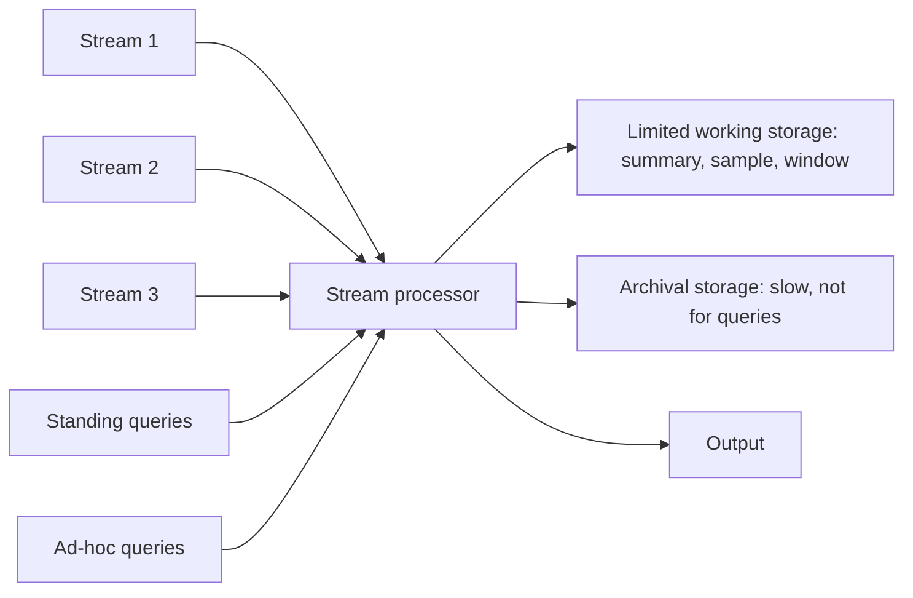

**In simple words:** a data stream is a sequence of elements that arrive continuously, so fast that we cannot store them all (sensor readings, clicks, stock ticks). A **Data Stream Management System (DSMS)** takes in streams and answers questions about them as the data flows past, using only a small amount of memory. It looks like a DBMS but is built for streams. <Cite id="stream-data-model-wiki-dsms" /> <Cite id="stream-data-model-babcock2002" />

**Why a DBMS is not enough:** a DBMS stores data first and queries it later, and it expects the full data set. A stream is endless, fast and seen once, so the system must answer from a small summary.

<Cite id="stream-data-model-cs246-slides" loc="slide 7" /> <Cite id="stream-data-model-gfg-dbms-dsms" />

**How it works**

1. **Streams** enter the processor at the same time. Each is a sequence of elements, for example (sensor id, time, temperature).
2. **Standing queries** are stored in the system and run on every new element, giving output whenever there is something to report. Example: report the highest temperature seen so far.
3. **Ad-hoc queries** are asked once, at a moment the user picks. Example: how many users logged in during the last 10 minutes. They can use only what is in working storage.
4. **Limited working storage** (main memory, sometimes disk) holds a summary, a sample or a window of recent elements, never the whole stream.
5. **Archival storage** (a warehouse or tape) keeps the full stream for later offline analysis. It is too slow to answer queries.
6. **Output** delivers the answers as an alert, a report or a feed into another system.

Inside, the system has an input buffer, a scheduler that picks the next operator, a query processor and a storage manager. Under overload it may drop some elements (load shedding). <Cite id="stream-data-model-geisler" />

| Point | DBMS | DSMS |
|---|---|---|
| Data | Stored, finite | Arrives continuously, unbounded |
| Queries | One-time | Standing (continuous) and ad-hoc |
| Memory | Disk, large | Small main memory |
| Answers | Exact | Often approximate |

**Applications:** sensor networks, stock-market feeds, network traffic monitoring, web click analysis.

**Conclusion:** a DSMS reads each element once, keeps only a small summary, runs standing queries all the time, and sends the full stream to an archive that cannot answer live questions.
