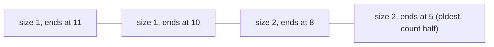

**In simple words:** hamare paas 0 aur 1 ki ek stream hai aur hume pata karna hai ki pichhle $N$ bits mein kitne 1 hain. Exact count ke liye saare $N$ bits memory mein chahiye. **DGIM algorithm** (Datar, Gionis, Indyk, Motwani, 2002) sirf lagbhag $\log N$ **buckets** rakhta hai, har bucket 1s ke ek group ka summary hai, aur $O(\log^2 N)$ bits mein sach ke 50 percent ke andar jawab deta hai. <Cite id="stream-counting-mmds-home" loc="§4.6" /> <Cite id="stream-counting-wiki-dsm" />

**Buckets.** Bucket do numbers rakhta hai: uska **size** (1s ki sankhya, hamesha 2 ki power) aur uske sabse recent 1 ka **timestamp**. Rules:

1. Bucket ka right end 1 hota hai.
2. Window ka har 1 kisi bucket mein hai, aur koi 1 do buckets mein nahi.
3. Har size ke ek ya do buckets hote hain.
4. Peeche jaate hue sizes kabhi kam nahi hote.
5. Jis bucket ka timestamp window se bahar chala jaaye wo hata diya jaata hai.

**Time $t$ pe bit aane par update**

1. Sabse purana bucket hata do agar uska timestamp $\le t - N$ ho.
2. 0 ho to aur kuch nahi badalta.
3. 1 ho to size 1 aur timestamp $t$ ka naya bucket banta hai.
4. Agar ab teen buckets ka size same ho, to sabse **purane do** ko merge karke double size ka ek bucket banao (timestamp unme se naye wale ka). Agle size ke liye bhi yehi dohrao.

**Pichhle $k$ bits ke liye query:** window ko chhoone wale sabse purane bucket $B$ se naye saare buckets ke sizes jodo, phir **$B$ ka aadha size** jodo. Error zyada se zyada $B$ ka aadha hai, aur $B$ sach count ke lagbhag aadhe se bada nahi hota, isliye error 50 percent se kam hai. <Cite id="stream-counting-mmds-home" loc="§4.6" />

<Sum>

<Given>

Stream (time 1 pehle): `1 1 0 1 1 1 0 1 0 1 1 0` (12 bits). Window $N = 8$. Bucket ko (size, timestamp) likhte hain.

</Given>

<Find>

har step ke baad buckets aur pichhle 8 bits mein 1s ka estimate.

</Find>

<Steps>

1. Update rules bit-by-bit lagao (0 se kuch nahi badalta, isliye sirf 1s dikhaye hain):

   | $t$ | Bit | Buckets after (newest first) | Why |
   |---|---|---|---|
   | 1 | 1 | (1,1) | naya bucket |
   | 2 | 1 | (1,2) (1,1) | size 1 ke do allowed hain |
   | 4 | 1 | (1,4) (2,2) | size 1 ke teen, to (1,2) aur (1,1) merge hoke (2,2) |
   | 5 | 1 | (1,5) (1,4) (2,2) | |
   | 6 | 1 | (1,6) (2,5) (2,2) | (1,5) aur (1,4) merge hoke (2,5) |
   | 8 | 1 | (1,8) (1,6) (2,5) (2,2) | |
   | 10 | 1 | (1,10) (2,8) (2,5) | (2,2) hata kyunki $2 \le 10 - 8$; phir (1,8) aur (1,6) merge hoke (2,8) |
   | 11 | 1 | (1,11) (1,10) (2,8) (2,5) | |

2. $t = 12$ pe 0 ke baad kuch nahi badalta. Window positions 5 se 12 hai (timestamps $12 - 8 = 4$ se bade).
3. Window ko chhoone wala sabse purana bucket $B = (2,5)$ hai. Isse naye buckets: $1 + 1 + 2 = 4$.
4. $B$ ka aadha jodo: $2 / 2 = 1$. Estimate $= 4 + 1 = 5$.

</Steps>

<Answer>

Final buckets (1,11) (1,10) (2,8) (2,5). Pichhle 8 bits mein 1s ka estimate $= 5$.

</Answer>

<Box kind="verify">

Seedha gino: positions 5 se 12 hain 1 1 0 1 0 1 1 0, jisme paanch 1 hain, to sach jawab 5 hai aur estimate match karta hai. Buckets time 4, 5, 6, 8, 10, 11 ke chhe 1s ko hold karte hain: $1 + 1 + 2 + 2 = 6$. Bucket (2,5) time 4 aur 5 ke 1s rakhta hai; sirf time 5 window ke andar hai, aur 2 ka aadha sanyog se theek 1 hai. Aam taur pe aadha ek andaza hai, isliye error 50 percent tak ho sakta hai.

</Box>

</Sum>

<Cite id="stream-counting-cs246-slides" loc="diagram" />

**Advantages:** bahut kam memory, fast update, error ki guarantee. **Disadvantages:** jawab sirf approximate hai, aur plain DGIM 0/1 streams ke liye hai.

**Conclusion:** DGIM $N$ bits ki window ko lagbhag $\log N$ buckets se badal deta hai aur phir bhi known error ke andar window count deta hai. <Cite id="stream-counting-wiki-streaming" />
