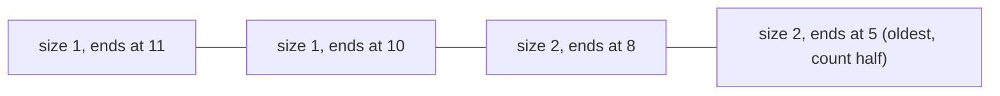

**In simple words:** we have a stream of 0s and 1s and want to know how many 1s are in the last $N$ bits. Counting exactly needs all $N$ bits in memory. The **DGIM algorithm** (Datar, Gionis, Indyk, Motwani, 2002) keeps only about $\log N$ **buckets**, each summarising a group of 1s, and gives an answer within 50 percent of the truth using $O(\log^2 N)$ bits. <Cite id="stream-counting-mmds-home" loc="§4.6" /> <Cite id="stream-counting-wiki-dsm" />

**Buckets.** A bucket stores two numbers: its **size** (the number of 1s, always a power of 2) and the **timestamp** of its most recent 1. The rules:

1. The right end of a bucket is a 1.
2. Every 1 in the window is in some bucket, and no 1 is in two buckets.
3. There are one or two buckets of each size.
4. Going back in time, sizes never decrease.
5. A bucket whose timestamp falls out of the window is dropped.

**Update when a bit arrives at time $t$**

1. Drop the oldest bucket if its timestamp is $\le t - N$.
2. A 0 changes nothing more.
3. A 1 creates a bucket of size 1 with timestamp $t$.
4. If three buckets now have the same size, merge the **two oldest** into one of double size (timestamp of the newer of the two). Repeat for the next size up.

**Query for the last $k$ bits:** add the sizes of all buckets newer than the oldest bucket $B$ that overlaps the window, then add **half of the size of $B$**. The error is at most half of $B$, and $B$ is never more than about half the true count, so the error is below 50 percent. <Cite id="stream-counting-mmds-home" loc="§4.6" />

<Sum>

<Given>

Stream (time 1 first): `1 1 0 1 1 1 0 1 0 1 1 0` (12 bits). Window $N = 8$. A bucket is written (size, timestamp).

</Given>

<Find>

the buckets after each step and the estimate of the 1s in the last 8 bits.

</Find>

<Steps>

1. Apply the update rules bit by bit (zeros change nothing, so only the 1s are shown):

   | $t$ | Bit | Buckets after (newest first) | Why |
   |---|---|---|---|
   | 1 | 1 | (1,1) | new bucket |
   | 2 | 1 | (1,2) (1,1) | two of size 1 is allowed |
   | 4 | 1 | (1,4) (2,2) | three of size 1, so (1,2) and (1,1) merge into (2,2) |
   | 5 | 1 | (1,5) (1,4) (2,2) | |
   | 6 | 1 | (1,6) (2,5) (2,2) | merge (1,5) and (1,4) into (2,5) |
   | 8 | 1 | (1,8) (1,6) (2,5) (2,2) | |
   | 10 | 1 | (1,10) (2,8) (2,5) | (2,2) dropped since $2 \le 10 - 8$; then (1,8) and (1,6) merge into (2,8) |
   | 11 | 1 | (1,11) (1,10) (2,8) (2,5) | |

2. After the 0 at $t = 12$ nothing changes. The window is positions 5 to 12 (timestamps above $12 - 8 = 4$).
3. The oldest bucket overlapping the window is $B = (2,5)$. Buckets newer than it: $1 + 1 + 2 = 4$.
4. Add half of $B$: $2 / 2 = 1$. Estimate $= 4 + 1 = 5$.

</Steps>

<Answer>

Final buckets (1,11) (1,10) (2,8) (2,5). Estimated number of 1s in the last 8 bits $= 5$.

</Answer>

<Box kind="verify">

Count directly: positions 5 to 12 are 1 1 0 1 0 1 1 0, which has five 1s, so the true answer is 5 and the estimate matches. The buckets also hold all six 1s at times 4, 5, 6, 8, 10, 11: $1 + 1 + 2 + 2 = 6$. Bucket (2,5) holds the 1s at times 4 and 5; only time 5 is inside the window, and half of 2 happens to be exactly 1. In general half is a guess, which is why the error can reach 50 percent.

</Box>

</Sum>

<Cite id="stream-counting-cs246-slides" loc="diagram" />

**Advantages:** tiny memory, fast update, guaranteed error bound. **Disadvantages:** answers are only approximate, and plain DGIM is for 0/1 streams.

**Conclusion:** DGIM replaces a window of $N$ bits by about $\log N$ buckets and still answers window counts within a known error. <Cite id="stream-counting-wiki-streaming" />
