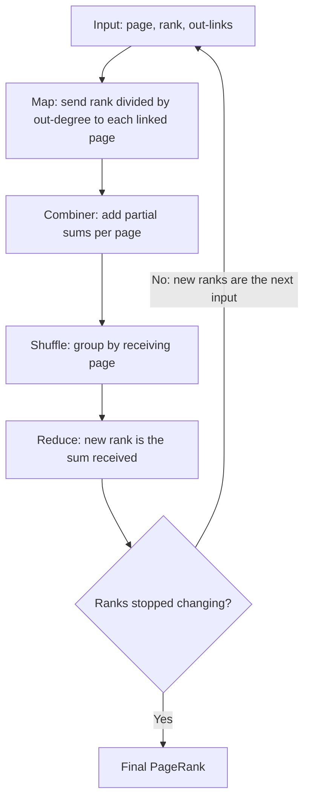

**In simple words:** PageRank har web page ko importance ka score deta hai. Page important hai agar important pages usse link karte hain. Socho ek surfer jo random links click karta rehta hai: jis page pe wo kitna time bitata hai, wahi uska rank hai. Har page apna rank apne out-links mein barabar baantta hai, aur ek update round $r \leftarrow M r$ hai, jahan $M$ link matrix hai. <Cite id="pagerank-wiki-webgraph" /> <Cite id="hadoop-ecosystem-mmds" loc="§5.1" />

**MapReduce se PageRank.** Ek round matrix-vector product hai, isliye ek MapReduce job hai, jo ranks ke badalna band hone tak dohraya jaata hai. <Cite id="hadoop-ecosystem-mmds" loc="§5.2.2" /> <Cite id="mapreduce-algorithms-gfg-pagerank" />

1. **Map:** input record mein page, uska rank $r_j$ aur out-links hote hain. Har out-link $i$ ke liye $(i, r_j / n_j)$ emit karo, jahan $n_j$ out-links ki sankhya hai. Link list ko bhi dobara emit karo taaki structure bacha rahe.
2. **Shuffle:** pairs ko receiving page ke hisaab se group karo.
3. **Reduce:** page $i$ ko mili values jodo, wahi uska naya rank hai. Combiner map side pe partial sums jod sakta hai, kyunki addition hisson mein ho sakta hai.

<Cite id="mapreduce-algorithms-gfg-pagerank" loc="diagram" />

<Sum>

<Given>

Teen pages: A, B aur C ko link karta hai; B, C ko link karta hai; C, A ko link karta hai. Shuru mein $r_0 = (\frac13, \frac13, \frac13)$.

</Given>

<Find>

ek round ka map output, shuffle aur reduce output.

</Find>

<Steps>

1. **Map.** A ke 2 out-links hain, to wo B aur C ko $\frac13 \div 2 = \frac16$ bhejta hai. B ka 1 out-link hai aur wo C ko $\frac13$ bhejta hai. C, A ko $\frac13$ bhejta hai. *Reason: page apna rank barabar baantta hai.*
2. **Shuffle.** A: [1/3]; B: [1/6]; C: [1/6, 1/3].
3. **Reduce (har page ke liye jodo).** A $= \frac13$, B $= \frac16$, C $= \frac16 + \frac13 = \frac12$.

</Steps>

<Answer>

$r_1 = (\frac13, \frac16, \frac12)$.

</Answer>

<Box kind="verify">

Total $\frac{2 + 1 + 3}{6} = 1$ hai, to koi rank khoya nahi. Matrix method wahi deta hai: A $= 1 \cdot r_C = \frac13$, B $= \frac12 r_A = \frac16$, C $= \frac12 r_A + r_B = \frac12$.

</Box>

</Sum>

**Dead end:** aisa page jiska koi out-link nahi. Uske rank ko kahin jaane ki jagah nahi, isliye total rank round-by-round leak hota jaata hai. **Spider trap:** pages ka ek group jiske saare out-links group ke andar hi rehte hain (sabse chhota wo page hai jo sirf khud ko link kare). Rank andar aata hai lekin bahar nahi jaata, to aakhir mein trap ke paas saara rank aa jaata hai. <Cite id="hadoop-ecosystem-mmds" loc="§5.1.4, §5.1.5" /> <Cite id="pagerank-wiki-spidertrap" />

<Sum>

<Given>

Dead end: A, B ko link karta hai, B, C ko link karta hai, C ka koi out-link nahi. Spider trap: A, B ko link karta hai, B, C ko link karta hai, C khud ko link karta hai. Dono $(\frac13, \frac13, \frac13)$ se shuru. Taxation mein $\beta = 0.8$.

</Given>

<Find>

ranks ka kya hota hai, aur fixes.

</Find>

<Steps>

1. **Dead end.** Round 1: A ko kuch nahi milta (koi in-link nahi), B ko A se $\frac13$ milta hai, C ko B se $\frac13$ milta hai, aur C ka apna $\frac13$ kho jaata hai. $r_1 = (0, \frac13, \frac13)$, total $\frac23$. Round 2: $r_2 = (0, 0, \frac13)$, total $\frac13$. Round 3: sab zero.
2. **Dead end ka fix: teleport.** C ko aise maano jaise wo har page ko barabar link karta hai. Round 1 mein uska $\frac13$ $\frac19$ har page mein baant jaata hai: $r_1 = (\frac19, \frac49, \frac49)$, total 1.
3. **Spider trap.** Round 1: A ko 0, B ko $\frac13$, C ko $\frac13 + \frac13 = \frac23$. $r_1 = (0, \frac13, \frac23)$. Round 2: $r_2 = (0, 0, 1)$. C ke paas sab kuch.
4. **Trap ka fix: taxation.** $r' = \beta M r + \frac{1 - \beta}{n}$ har page mein jodo, jahan $\frac{1 - 0.8}{3} = \frac1{15}$. $M r_0 = (0, \frac13, \frac23)$ se: A $= 0 + \frac1{15} = \frac1{15}$; B $= 0.8 \times \frac13 + \frac1{15} = \frac13$; C $= 0.8 \times \frac23 + \frac1{15} = \frac35$.

</Steps>

<Answer>

Dead end: total $1 \to \frac23 \to \frac13 \to 0$ girta hai. Spider trap: ranks $(0, 0, 1)$ ho jaate hain. Taxation ke saath trap round $r_1 = (\frac1{15}, \frac13, \frac35)$ deta hai, to A aur B ke paas kuch rank rehta hai.

</Answer>

<Box kind="verify">

Dead end: har round mein khoya rank C pe baitha rank hai, yani $\frac13$, phir $\frac13$, phir $\frac13$ ($1 \to \frac23 \to \frac13 \to 0$). Teleport total: $\frac{1 + 4 + 4}{9} = 1$. Taxation total: $\frac{1 + 5 + 9}{15} = 1$.

</Box>

</Sum>

| Problem | Kya galat hota hai | Fix |
|---|---|---|
| Dead end | Total rank 0 tak leak hota hai | Hata do, ya usse teleport karo, ya tax lagao |
| Spider trap | Ek group saara rank kha leta hai | Taxation: probability $1 - \beta$ se random page pe jump |

**Conclusion:** PageRank baar-baar matrix-vector multiplication hai, jo MapReduce map (rank baanto), shuffle (group) aur reduce (jodo) se karta hai. Taxation aur dead ends se teleporting real web pe ranks ko meaningful rakhte hain.
