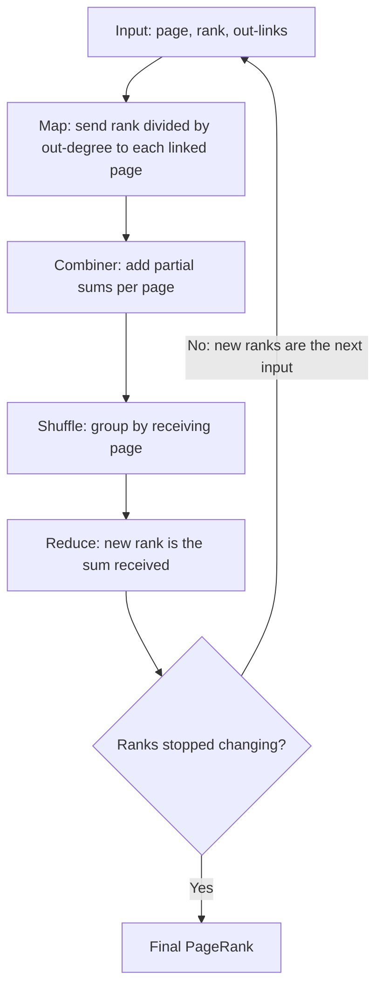

**In simple words:** PageRank gives each web page a score of importance. A page is important if important pages link to it. Imagine a surfer who keeps clicking random links: the share of time spent on a page is its rank. Each page splits its rank equally among its out-links, and one update round is $r \leftarrow M r$, where $M$ is the link matrix. <Cite id="pagerank-wiki-webgraph" /> <Cite id="hadoop-ecosystem-mmds" loc="§5.1" />

**PageRank using MapReduce.** One round is a matrix-vector product, so it is one MapReduce job, repeated until ranks stop changing. <Cite id="hadoop-ecosystem-mmds" loc="§5.2.2" /> <Cite id="mapreduce-algorithms-gfg-pagerank" />

1. **Map:** the input record is a page, its rank $r_j$ and its out-links. For each out-link $i$ emit $(i, r_j / n_j)$, where $n_j$ is the number of out-links. Also re-emit the link list so the structure survives.
2. **Shuffle:** group the pairs by receiving page.
3. **Reduce:** add the values received by page $i$ to get its new rank. A combiner may add partial sums on the map side, since addition can be done in parts.

<Cite id="mapreduce-algorithms-gfg-pagerank" loc="diagram" />

<Sum>

<Given>

Three pages: A links to B and C; B links to C; C links to A. Start with $r_0 = (\frac13, \frac13, \frac13)$.

</Given>

<Find>

the map output, shuffle and reduce output of one round.

</Find>

<Steps>

1. **Map.** A has 2 out-links, so it sends $\frac13 \div 2 = \frac16$ to B and to C. B has 1 out-link and sends $\frac13$ to C. C sends $\frac13$ to A. *Reason: a page splits its rank equally.*
2. **Shuffle.** A: [1/3]; B: [1/6]; C: [1/6, 1/3].
3. **Reduce (add per page).** A $= \frac13$, B $= \frac16$, C $= \frac16 + \frac13 = \frac12$.

</Steps>

<Answer>

$r_1 = (\frac13, \frac16, \frac12)$.

</Answer>

<Box kind="verify">

The total is $\frac{2 + 1 + 3}{6} = 1$, so no rank was lost. The matrix method gives the same: A $= 1 \cdot r_C = \frac13$, B $= \frac12 r_A = \frac16$, C $= \frac12 r_A + r_B = \frac12$.

</Box>

</Sum>

**Dead end:** a page with no out-links. Its rank has nowhere to go, so the total rank leaks away round by round. **Spider trap:** a group of pages whose out-links all stay inside the group (the smallest is a page linking only to itself). Rank enters but never leaves, so the trap ends up with all the rank. <Cite id="hadoop-ecosystem-mmds" loc="§5.1.4, §5.1.5" /> <Cite id="pagerank-wiki-spidertrap" />

<Sum>

<Given>

Dead end: A links to B, B links to C, C has no out-links. Spider trap: A links to B, B links to C, C links to itself. Both start at $(\frac13, \frac13, \frac13)$. Taxation uses $\beta = 0.8$.

</Given>

<Find>

what happens to the ranks, and the fixes.

</Find>

<Steps>

1. **Dead end.** Round 1: A gets nothing (no in-links), B gets $\frac13$ from A, C gets $\frac13$ from B, and C's own $\frac13$ is lost. $r_1 = (0, \frac13, \frac13)$, total $\frac23$. Round 2: $r_2 = (0, 0, \frac13)$, total $\frac13$. Round 3: all zero.
2. **Fix for a dead end: teleport.** Treat C as linking to every page equally. In round 1 its $\frac13$ is shared as $\frac19$ each: $r_1 = (\frac19, \frac49, \frac49)$, total 1.
3. **Spider trap.** Round 1: A gets 0, B gets $\frac13$, C gets $\frac13 + \frac13 = \frac23$. $r_1 = (0, \frac13, \frac23)$. Round 2: $r_2 = (0, 0, 1)$. C holds everything.
4. **Fix for a trap: taxation.** $r' = \beta M r + \frac{1 - \beta}{n}$ added to every page, with $\frac{1 - 0.8}{3} = \frac1{15}$. From $M r_0 = (0, \frac13, \frac23)$: A $= 0 + \frac1{15} = \frac1{15}$; B $= 0.8 \times \frac13 + \frac1{15} = \frac13$; C $= 0.8 \times \frac23 + \frac1{15} = \frac35$.

</Steps>

<Answer>

Dead end: totals fall $1 \to \frac23 \to \frac13 \to 0$. Spider trap: ranks go $(0, 0, 1)$. With taxation the trap round gives $r_1 = (\frac1{15}, \frac13, \frac35)$, so A and B keep some rank.

</Answer>

<Box kind="verify">

Dead end: the rank lost each round equals the rank that sat on C, namely $\frac13$, then $\frac13$, then $\frac13$ ($1 \to \frac23 \to \frac13 \to 0$). Teleport total: $\frac{1 + 4 + 4}{9} = 1$. Taxation total: $\frac{1 + 5 + 9}{15} = 1$.

</Box>

</Sum>

| Problem | What goes wrong | Fix |
|---|---|---|
| Dead end | Total rank leaks to 0 | Drop it, or teleport from it, or tax |
| Spider trap | One group takes all the rank | Taxation: jump to a random page with probability $1 - \beta$ |

**Conclusion:** PageRank is repeated matrix-vector multiplication, which MapReduce does as map (split rank), shuffle (group) and reduce (add). Taxation, with teleporting from dead ends, keeps the ranks meaningful on the real web.
