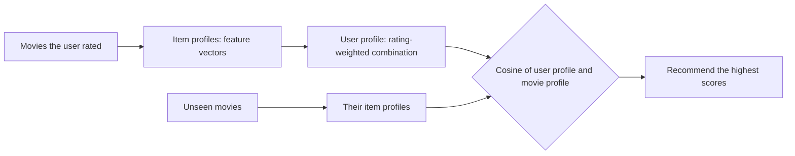

**In simple words:** content-based filtering aise movies recommend karta hai jo user ki pehle pasand ki hui movies jaisi hon, aur similarity movie ki apni properties (genre, actors, director, plot words) se judge hoti hai, doosre users ne kya kiya us se nahi. Ye us dukaandar jaisa hai jo aapko thriller pasand aane par doosre thrillers ki shelf pe le jaata hai. <Cite id="recommendation-systems-mmds-slides" /> <Cite id="recommendation-systems-google-cb" />

<Cite id="recommendation-systems-mmds-slides" loc="diagram" /> <Cite id="recommendation-systems-gfg-cb" loc="diagram" />

**Steps**

1. **Item profile.** Har movie ko features ke vector se describe karo: har genre ya actor ke liye ek position, movie mein ho to 1. Plot text ke liye TF-IDF use hota hai, jo us word ko high score deta hai jo is movie ke text mein zyada ho lekin doosron mein kam. <Cite id="recommendation-systems-wiki-tfidf" />
2. **User profile.** User ki rate ki hui movies ke profiles ko milao. Accha tareeka hai har ek ko (rating minus user ki average rating) se weight karna, taaki pasand ki movies profile ko apne features ki taraf kheenchein aur napasand wali door dhakelein.
3. **Match.** Har unseen movie ko uske profile aur user profile ke cosine se score karo: $\cos(x, i) = \dfrac{x \cdot i}{\lVert x \rVert \, \lVert i \rVert}$.
4. **Recommend** sabse zyada score wali movies.

<Sum>

<Given>

Features (Action, Comedy, Romance, Sci-Fi). User ne M1 = (1,0,0,1) ko 5 stars, M2 = (1,0,0,0) ko 4 stars, M3 = (0,0,1,0) ko 1 star diya. Unseen: N1 = (1,0,0,1), N2 = (0,1,1,0), N3 = (1,1,0,0).

</Given>

<Find>

user profile aur har unseen movie ka uske saath cosine.

</Find>

<Steps>

1. Average rating $= (5 + 4 + 1)/3 = 10/3$. Weights: M1 $5/3$, M2 $2/3$, M3 $-7/3$. 3 se multiply karo (cosine scale ignore karta hai): $5, 2, -7$. *Reason: average se upar ki ratings kheenchti hain, neeche ki dhakelti hain.*
2. User profile $= 5 \cdot M1 + 2 \cdot M2 - 7 \cdot M3 = (7, 0, -7, 5)$. Uski length $\sqrt{49 + 49 + 25} = \sqrt{123} \approx 11.09$.
3. Har unseen movie mein do 1 hain, to length $\sqrt{2} \approx 1.414$, aur denominator $11.09 \times 1.414 = 15.68$.
4. Dot products: N1 $= 7 + 5 = 12$; N2 $= 0 - 7 = -7$; N3 $= 7 + 0 = 7$.
5. Cosines: N1 $= 12/15.68 \approx 0.77$; N2 $\approx -0.45$; N3 $\approx 0.45$.

</Steps>

<Answer>

N1 (Action aur Sci-Fi, cosine lagbhag 0.77) recommend karo, phir N3 (lagbhag 0.45). N2 (Comedy aur Romance, lagbhag $-0.45$) wo hai jo user ko pasand nahi aayegi.

</Answer>

<Box kind="verify">

Ranking common sense se match karti hai: user ko Action aur Sci-Fi wali movie bahut pasand aayi, Action se khush tha, aur Romance ko 1 star diya. Ek dot product dobara nikalo: $7 \times 1 + 0 \times 0 + (-7) \times 0 + 5 \times 1 = 12$.

</Box>

</Sum>

| Advantages | Disadvantages |
|---|---|
| Doosre users ka data nahi chahiye, to naye items ka cold start nahi | Accha features dhoondhna mushkil (music, images, video) |
| Nayi aur unpopular movies recommend kar sakta hai | Over-specialisation: bas usi jaisa aur |
| Reason bata sakta hai (same genre ya actor) | Naye user ka profile nahi hota |

**Conclusion:** content-based filtering movie features se taste profile banata hai aur cosine similarity se sabse paas ki unseen movies recommend karta hai. <Cite id="recommendation-systems-gfg-cb" />

Exam mein English mein likho: "Content-based filtering recommends items whose profiles are similar to the user profile built from items the user liked."
