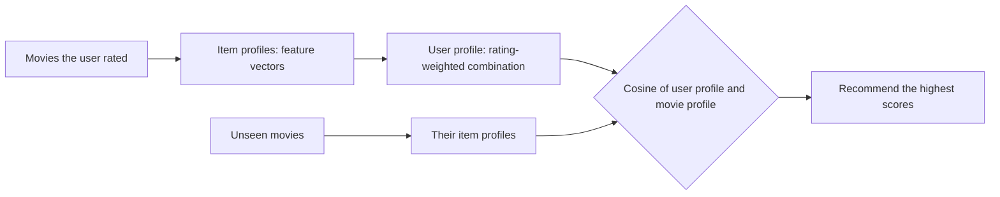

**In simple words:** content-based filtering recommends movies **similar to the movies the user already liked**, judging similarity from the movie's own properties (genre, actors, director, plot words), not from what other users did. It is like a shopkeeper who walks you to the shelf of other thrillers because you liked thrillers. <Cite id="recommendation-systems-mmds-slides" /> <Cite id="recommendation-systems-google-cb" />

<Cite id="recommendation-systems-mmds-slides" loc="diagram" /> <Cite id="recommendation-systems-gfg-cb" loc="diagram" />

**Steps**

1. **Item profile.** Describe each movie by a vector of features: one position per genre or actor, 1 if the movie has it. For plot text use TF-IDF, which scores a word high if it is frequent in this movie's text but rare in others. <Cite id="recommendation-systems-wiki-tfidf" />
2. **User profile.** Combine the profiles of the movies the user rated. A good way is to weight each by (rating minus the user's average rating), so liked movies pull the profile towards their features and disliked ones push away.
3. **Match.** Score every unseen movie by the cosine of its profile with the user profile: $\cos(x, i) = \dfrac{x \cdot i}{\lVert x \rVert \, \lVert i \rVert}$.
4. **Recommend** the top-scoring movies.

<Sum>

<Given>

Features (Action, Comedy, Romance, Sci-Fi). The user rated M1 = (1,0,0,1) with 5 stars, M2 = (1,0,0,0) with 4 stars, M3 = (0,0,1,0) with 1 star. Unseen: N1 = (1,0,0,1), N2 = (0,1,1,0), N3 = (1,1,0,0).

</Given>

<Find>

the user profile and the cosine of each unseen movie with it.

</Find>

<Steps>

1. Average rating $= (5 + 4 + 1)/3 = 10/3$. Weights: M1 $5/3$, M2 $2/3$, M3 $-7/3$. Multiply by 3 (cosine ignores scale): $5, 2, -7$. *Reason: above-average ratings pull, below-average push.*
2. User profile $= 5 \cdot M1 + 2 \cdot M2 - 7 \cdot M3 = (7, 0, -7, 5)$. Its length is $\sqrt{49 + 49 + 25} = \sqrt{123} \approx 11.09$.
3. Each unseen movie has two 1s, so its length is $\sqrt{2} \approx 1.414$, and the denominator is $11.09 \times 1.414 = 15.68$.
4. Dot products: N1 $= 7 + 5 = 12$; N2 $= 0 - 7 = -7$; N3 $= 7 + 0 = 7$.
5. Cosines: N1 $= 12/15.68 \approx 0.77$; N2 $\approx -0.45$; N3 $\approx 0.45$.

</Steps>

<Answer>

Recommend N1 (Action and Sci-Fi, cosine about 0.77), then N3 (about 0.45). N2 (Comedy and Romance, about $-0.45$) is the one the user would dislike.

</Answer>

<Box kind="verify">

The ranking matches common sense: the user loved the Action and Sci-Fi movie, was happy with Action, and gave Romance 1 star. Recompute one dot product: $7 \times 1 + 0 \times 0 + (-7) \times 0 + 5 \times 1 = 12$.

</Box>

</Sum>

| Advantages | Disadvantages |
|---|---|
| Needs no data from other users, so no cold start for new items | Good features are hard to find (music, images, video) |
| Can recommend new and unpopular movies | Over-specialisation: only more of the same |
| Can explain the reason (shared genre or actor) | A new user has no profile |

**Conclusion:** content-based filtering builds a taste profile from movie features and recommends the closest unseen movies by cosine similarity. <Cite id="recommendation-systems-gfg-cb" />
