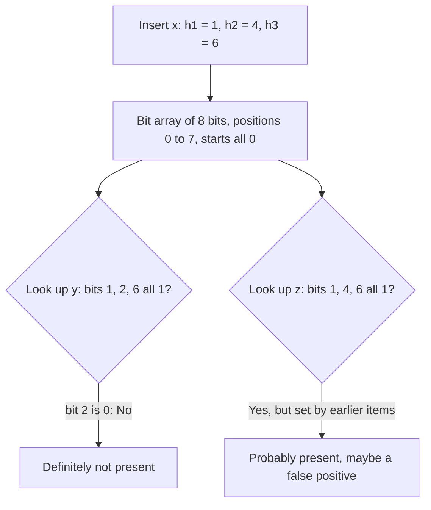

**In simple words:** Bloom filter (Burton Bloom, 1970) ek chhota bit array aur $k$ hash functions hain jo batate hain ki koi item set mein hai ya nahi. Wo ek aise item ke liye "yes" bol sakta hai jo set mein nahi hai (**false positive**), lekin set ke item ke liye **kabhi "no" nahi bolta** (false negative nahi). <Cite id="stream-counting-mmds-home" loc="§4.3" /> <Cite id="stream-counting-wiki-bloom" />

**Kyun chahiye:** mail server ke paas ek arab achhe addresses ki list hai aur use har sender jaldi check karna hai. Poori list memory mein rakhna bahut bada hai, aur har baar disk lookup slow hai. Bloom filter har address ke liye kuch bits memory mein rakhta hai: "no" pakka hota hai, aur "yes" ko sirf zarurat pe slow exact list se check karte hain.

**Kaise kaam karta hai**

1. $m$ bits se shuru karo, sab 0, aur $k$ hash functions jo $0$ se $m-1$ tak positions dete hain.
2. **Insert** $x$: bits $h_1(x), \dots, h_k(x)$ ko 1 kar do.
3. **Look up** $y$: agar saare $k$ bits 1 hain to "possibly present" bolo; agar koi bhi 0 hai to "definitely absent".

<Cite id="stream-counting-gfg-bloom" loc="diagram" /> <Cite id="stream-counting-wiki-bloom" loc="diagram" />

<Sum>

<Given>

$m = 10$ bits, $k = 2$ hash functions $h_1(x) = x \bmod 10$ aur $h_2(x) = (3x + 1) \bmod 10$. 7, 15, 24 insert karo. Phir 8 aur 12 look up karo.

</Given>

<Find>

bit array aur jawab.

</Find>

<Steps>

1. **Insert 7.** $h_1 = 7$, $h_2 = 22 \bmod 10 = 2$. Bits 7, 2 set.
2. **Insert 15.** $h_1 = 5$, $h_2 = 46 \bmod 10 = 6$. Bits 5, 6 set.
3. **Insert 24.** $h_1 = 4$, $h_2 = 73 \bmod 10 = 3$. Bits 4, 3 set.
4. **Array.**

   | Position | 0 | 1 | 2 | 3 | 4 | 5 | 6 | 7 | 8 | 9 |
   |---|---|---|---|---|---|---|---|---|---|---|
   | Bit | 0 | 0 | 1 | 1 | 1 | 1 | 1 | 1 | 0 | 0 |

5. **Look up 8.** $h_1 = 8$, bit 8 0 hai, to **absent**. *Reason: ek 0 bit kaafi hai.*
6. **Look up 12.** $h_1 = 2$ aur $h_2 = 37 \bmod 10 = 7$; dono bits 1 hain, to filter **present** bolta hai.

</Steps>

<Answer>

Array `0011111100`. 8 absent hai (sahi). 12 present bataya gaya lekin kabhi insert nahi hua, to ye **false positive** hai.

</Answer>

<Box kind="verify">

Har inserted item pass hona chahiye: 7 ke bits 7, 2; 15 ke 5, 6; 24 ke 4, 3; sab 1 hain, to false negative nahi hai. 10 mein se chhe bits 1 hain.

</Box>

</Sum>

**Analysis (false-positive rate).** $m$ = bits, $n$ = items, $k$ = hashes. Ek hash kisi diye hue bit ko $1 - 1/m$ probability se chhodta hai, to $kn$ hashes ke baad bit abhi 0 hone ki probability $(1 - 1/m)^{kn} \approx e^{-kn/m}$ hai. Naya item galat accept tab hota hai jab uske saare $k$ bits 1 hon, isliye

$$
\text{false-positive rate} \approx \left(1 - e^{-kn/m}\right)^k
$$

Hashes ki best sankhya $k = \dfrac{m}{n}\ln 2$ hai, jisse lagbhag aadhe bits 1 hote hain. Bahut kam hashes weak filter dete hain; bahut zyada array bhar dete hain. <Cite id="stream-counting-mmds-home" loc="§4.3" />

<Sum>

<Given>

$n = 1000$ items aur $m = 8000$ bits.

</Given>

<Find>

$k = 1$, $2$, $6$ ke liye false-positive rate aur best $k$.

</Find>

<Steps>

1. $kn/m = k/8$.
2. $k = 1$: $(1 - e^{-0.125})^1 = 0.1175$, lagbhag 11.8 percent.
3. $k = 2$: $(1 - e^{-0.25})^2 = 0.2212^2 = 0.0489$, lagbhag 4.9 percent.
4. $k = 6$: $(1 - e^{-0.75})^6 = 0.5276^6 = 0.0216$, lagbhag 2.2 percent.
5. Best $k = 8 \ln 2 = 5.55$, to 5 aur 6 try karo: 0.02168 aur 0.02158. $k = 6$ lo.

</Steps>

<Answer>

$k = 1, 2, 6$ ke liye lagbhag 11.8, 4.9 aur 2.2 percent; best $k$ 6 hai.

</Answer>

<Box kind="verify">

$k = 7$ deta hai $(1 - e^{-0.875})^7 = 0.0229$, jo $k = 6$ se bada hai, to 6 hi minimum hai.

</Box>

</Sum>

**Advantages:** bahut kam memory, $O(k)$ insert aur lookup, false negative nahi. **Disadvantages:** false positives, deletion nahi (counting Bloom filter allow karta hai), items ki list nahi nikal sakte. **Uses:** spam filtering, aur Cassandra aur HBase wo disk files skip kar dete hain jinka Bloom filter "yahan nahi" bolta hai. <Cite id="stream-counting-cass-bloom" />
