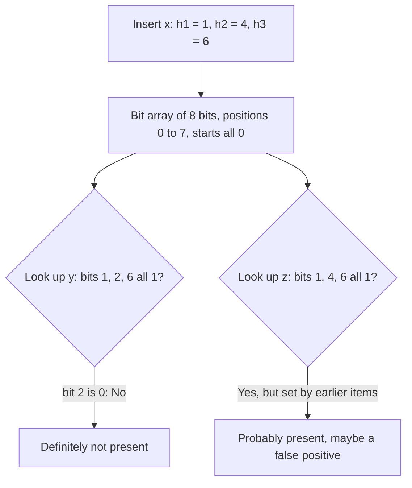

**In simple words:** a Bloom filter (Burton Bloom, 1970) is a small bit array plus $k$ hash functions that tells whether an item is in a set. It may say "yes" for an item that is not in the set (**false positive**), but it **never says "no" for an item that is in the set** (no false negatives). <Cite id="stream-counting-mmds-home" loc="§4.3" /> <Cite id="stream-counting-wiki-bloom" />

**Why it is needed:** a mail server has a list of a billion good addresses and must check each sender quickly. Keeping the whole list in memory is huge, and a disk lookup each time is slow. A Bloom filter keeps a few bits per address in memory: "no" is certain, and "yes" is checked against the slow exact list only when needed.

**How it works**

1. Start with $m$ bits, all 0, and $k$ hash functions giving positions $0$ to $m-1$.
2. **Insert** $x$: set the bits $h_1(x), \dots, h_k(x)$ to 1.
3. **Look up** $y$: if all $k$ bits are 1 answer "possibly present"; if any is 0 answer "definitely absent".

<Cite id="stream-counting-gfg-bloom" loc="diagram" /> <Cite id="stream-counting-wiki-bloom" loc="diagram" />

<Sum>

<Given>

$m = 10$ bits, $k = 2$ hash functions $h_1(x) = x \bmod 10$ and $h_2(x) = (3x + 1) \bmod 10$. Insert 7, 15, 24. Then look up 8 and 12.

</Given>

<Find>

the bit array and the answers.

</Find>

<Steps>

1. **Insert 7.** $h_1 = 7$, $h_2 = 22 \bmod 10 = 2$. Set bits 7, 2.
2. **Insert 15.** $h_1 = 5$, $h_2 = 46 \bmod 10 = 6$. Set bits 5, 6.
3. **Insert 24.** $h_1 = 4$, $h_2 = 73 \bmod 10 = 3$. Set bits 4, 3.
4. **Array.**

   | Position | 0 | 1 | 2 | 3 | 4 | 5 | 6 | 7 | 8 | 9 |
   |---|---|---|---|---|---|---|---|---|---|---|
   | Bit | 0 | 0 | 1 | 1 | 1 | 1 | 1 | 1 | 0 | 0 |

5. **Look up 8.** $h_1 = 8$, bit 8 is 0, so **absent**. *Reason: one 0 bit is enough.*
6. **Look up 12.** $h_1 = 2$ and $h_2 = 37 \bmod 10 = 7$; both bits are 1, so the filter says **present**.

</Steps>

<Answer>

Array `0011111100`. 8 is absent (correct). 12 is reported present but was never inserted, so it is a **false positive**.

</Answer>

<Box kind="verify">

Every inserted item must pass: 7 uses bits 7, 2; 15 uses 5, 6; 24 uses 4, 3; all are 1, so there is no false negative. Six of the 10 bits are 1.

</Box>

</Sum>

**Analysis (false-positive rate).** Let $m$ = bits, $n$ = items, $k$ = hashes. One hash misses a given bit with probability $1 - 1/m$, so after $kn$ hashes a bit is still 0 with probability $(1 - 1/m)^{kn} \approx e^{-kn/m}$. A new item is wrongly accepted when all its $k$ bits are 1, so

$$
\text{false-positive rate} \approx \left(1 - e^{-kn/m}\right)^k
$$

The best number of hashes is $k = \dfrac{m}{n}\ln 2$, which makes about half the bits 1. Too few hashes filter weakly; too many fill the array. <Cite id="stream-counting-mmds-home" loc="§4.3" />

<Sum>

<Given>

$n = 1000$ items and $m = 8000$ bits.

</Given>

<Find>

the false-positive rate for $k = 1$, $2$, $6$ and the best $k$.

</Find>

<Steps>

1. $kn/m = k/8$.
2. $k = 1$: $(1 - e^{-0.125})^1 = 0.1175$, about 11.8 percent.
3. $k = 2$: $(1 - e^{-0.25})^2 = 0.2212^2 = 0.0489$, about 4.9 percent.
4. $k = 6$: $(1 - e^{-0.75})^6 = 0.5276^6 = 0.0216$, about 2.2 percent.
5. Best $k = 8 \ln 2 = 5.55$, so try 5 and 6: 0.02168 and 0.02158. Use $k = 6$.

</Steps>

<Answer>

About 11.8, 4.9 and 2.2 percent for $k = 1, 2, 6$; the best $k$ is 6.

</Answer>

<Box kind="verify">

$k = 7$ gives $(1 - e^{-0.875})^7 = 0.0229$, larger than for $k = 6$, so 6 is the minimum.

</Box>

</Sum>

**Advantages:** tiny memory, $O(k)$ insert and lookup, no false negatives. **Disadvantages:** false positives, no deletion (a counting Bloom filter allows it), cannot list the items. **Uses:** spam filtering, and Cassandra and HBase skip disk files whose Bloom filter says "not here". <Cite id="stream-counting-cass-bloom" />
