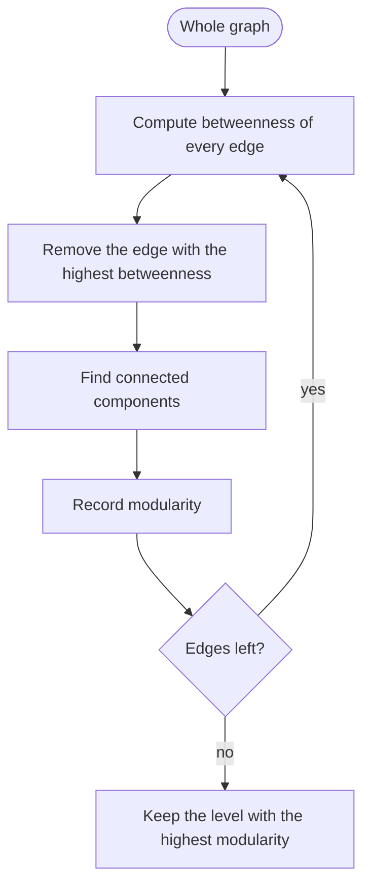
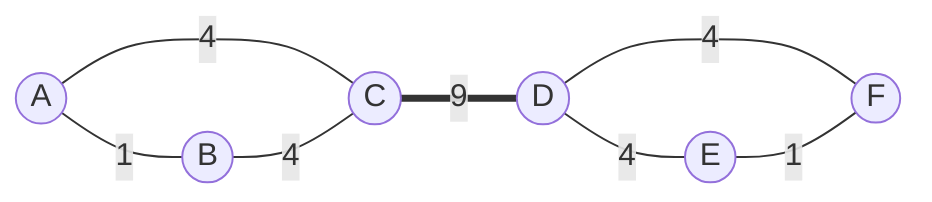

**In simple words:** social network ek graph hai: log nodes hain aur rishte (friend, follow, message) edges hain. Graph ko cluster karne ka matlab nodes ko **communities** mein baantna hai jinke andar bahut edges hon aur groups ke beech kam. <Cite id="social-network-graphs-wiki-community" /> <Cite id="social-network-graphs-mmds-book" loc="§10.1" />

**Normal clustering kyun fail hoti hai**

- Coordinates nahi hain, to average karne ke liye centre point nahi hai (k-means use nahi ho sakta).
- Sirf "edge" ya "no edge" pata hai, to zyadatar distances barabar aate hain.
- Communities overlap karti hain: ek insaan family group, class aur hobby group teeno mein hota hai.
- Real graphs mein lakhon nodes hote hain, to slow methods bahar.

Isliye special methods graph ka structure khud use karte hain. <Cite id="social-network-graphs-mmds-book" loc="§10.2" />

**Girvan-Newman method (2002).** Jo edges do communities ko jodti hain wo bahut shortest paths carry karti hain, isliye unka **betweenness** sabse zyada hota hai: saare node pairs ke shortest paths ki wo sankhya jo us edge se guzarte hain (ties mein credit baant jaata hai). Unhe hata do to communities alag ho jaati hain. <Cite id="social-network-graphs-girvan-newman2002" /> <Cite id="social-network-graphs-gfg-girvan-newman" />

1. Har edge ka betweenness nikalo.
2. Sabse zyada wali edge hata do.
3. Bachi edges ka betweenness **dobara nikalo**, kyunki shortest paths badal jaate hain.
4. Jab tak edges khatam na ho dohrao, har baar connected components note karte hue.
5. Sabse acchi **modularity** wala level rakho: $Q = \sum_c \left[ \dfrac{e_c}{m} - \left(\dfrac{d_c}{2m}\right)^2 \right]$, jahan $m$ edges ki sankhya, $e_c$ group $c$ ke andar ki edges aur $d_c$ uske nodes ki degrees ka sum hai.

<Cite id="social-network-graphs-gfg-girvan-newman" loc="diagram" />

<Sum>

<Given>

Chhe log. Triangle A, B, C aur triangle D, E, F, ek edge C-D se jude hain. Edges: A-B, A-C, B-C, C-D, D-E, D-F, E-F (7 edges).

</Given>

<Find>

edge betweenness, pehli hataai gayi edge, aur communities.

</Find>

<Steps>

1. $\binom{6}{2} = 15$ pairs hain aur har shortest path unique hai, to har pair apne path ki har edge mein 1 jodta hai.
2. **C-D.** \{A, B, C\} aur \{D, E, F\} ke beech ka har pair isse guzarta hai: $3 \times 3 = 9$.
3. **A-C.** Pairs A-C, A-D, A-E, A-F: 4. **B-C** symmetry se: 4.
4. **A-B.** Sirf pair A-B: 1. **E-F** waise hi: 1.
5. **D-E.** Pairs D-E, C-E, A-E, B-E: 4. **D-F** symmetry se: 4.
6. Sabse zyada C-D hai, 9. Hata do: components \{A, B, C\} aur \{D, E, F\} hain.
7. **Modularity**, $m = 7$. \{A, B, C\} ke liye: $e = 3$, degrees $2 + 2 + 3 = 7$, to $\frac37 - (\frac{7}{14})^2 = 0.4286 - 0.25 = 0.1786$. Doosra group bhi wahi deta hai. $Q = 0.357$.

</Steps>

<Answer>

C-D ka betweenness sabse zyada hai (9). Hatane se do communities milti hain, \{A, B, C\} aur \{D, E, F\}, modularity $Q = 5/14 \approx 0.357$ ke saath.

</Answer>

<Box kind="verify">

Betweenness values: 1, 4, 4, 9, 4, 4, 1, jinka sum 27 hai. Saare shortest-path lengths ka sum bhi 27 hona chahiye: triangles ke andar $3 + 3 = 6$; beech mein A, D, E, F se $2 + 3 + 3 = 8$ door hai, B 8, aur C $1 + 2 + 2 = 5$, to $6 + 8 + 8 + 5 = 27$. Match karta hai.

</Box>

</Sum>

<Cite id="social-network-graphs-wiki-girvan-newman" />

**Limitations:** slow (har round mein har node se shortest paths), ties order pe depend karti hain, aur har insaan sirf ek community mein aata hai. Overlapping communities ke liye clique percolation method jaise doosre methods chahiye.

**Conclusion:** social-graph clustering communities ko jodne wali high-betweenness edges kaat deta hai, phir sabse acchi modularity wala split rakhta hai.
