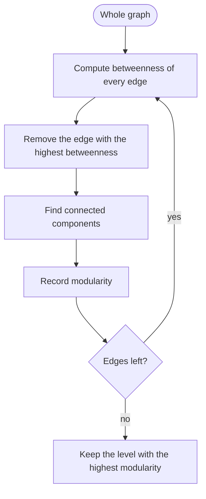
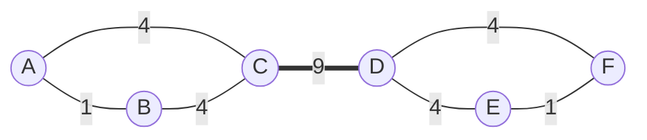

**In simple words:** a social network is a graph: people are nodes and relationships (friend, follow, message) are edges. Clustering the graph means splitting the nodes into **communities** with many edges inside each group and few edges between groups. <Cite id="social-network-graphs-wiki-community" /> <Cite id="social-network-graphs-mmds-book" loc="§10.1" />

**Why ordinary clustering struggles**

- There are no coordinates, so there is no centre point to average (k-means cannot be used).
- The only facts are "edge" or "no edge", so most distances tie.
- Communities overlap: one person is in a family group, a class and a hobby group.
- Real graphs have millions of nodes, so slow methods are out.

So special methods use the graph structure itself. <Cite id="social-network-graphs-mmds-book" loc="§10.2" />

**Girvan-Newman method (2002).** Edges that join two communities carry many shortest paths, so they have the highest **betweenness**: the number of shortest paths between all pairs of nodes that run through the edge (ties share the credit). Remove them and the communities fall apart. <Cite id="social-network-graphs-girvan-newman2002" /> <Cite id="social-network-graphs-gfg-girvan-newman" />

1. Compute the betweenness of every edge.
2. Remove the edge with the highest value.
3. **Recompute** the betweenness of the remaining edges, since shortest paths change.
4. Repeat until no edges are left, noting the connected components each time.
5. Keep the level with the best **modularity** $Q = \sum_c \left[ \dfrac{e_c}{m} - \left(\dfrac{d_c}{2m}\right)^2 \right]$, where $m$ is the number of edges, $e_c$ the edges inside group $c$ and $d_c$ the sum of its node degrees.

<Cite id="social-network-graphs-gfg-girvan-newman" loc="diagram" />

<Sum>

<Given>

Six people. Triangle A, B, C and triangle D, E, F, joined by one edge C-D. Edges: A-B, A-C, B-C, C-D, D-E, D-F, E-F (7 edges).

</Given>

<Find>

the edge betweenness, the first edge removed, and the communities.

</Find>

<Steps>

1. There are $\binom{6}{2} = 15$ pairs and every shortest path is unique, so each pair adds 1 to every edge on its path.
2. **C-D.** Every pair with one node in \{A, B, C\} and one in \{D, E, F\} crosses it: $3 \times 3 = 9$.
3. **A-C.** Pairs A-C, A-D, A-E, A-F: 4. **B-C** by symmetry: 4.
4. **A-B.** Only the pair A-B: 1. **E-F** similarly: 1.
5. **D-E.** Pairs D-E, C-E, A-E, B-E: 4. **D-F** by symmetry: 4.
6. The highest is C-D with 9. Remove it: the components are \{A, B, C\} and \{D, E, F\}.
7. **Modularity** with $m = 7$. For \{A, B, C\}: $e = 3$, degrees $2 + 2 + 3 = 7$, so $\frac37 - (\frac{7}{14})^2 = 0.4286 - 0.25 = 0.1786$. The other group gives the same. $Q = 0.357$.

</Steps>

<Answer>

C-D has the highest betweenness (9). Removing it gives two communities, \{A, B, C\} and \{D, E, F\}, with modularity $Q = 5/14 \approx 0.357$.

</Answer>

<Box kind="verify">

Betweenness values: 1, 4, 4, 9, 4, 4, 1, which add to 27. The sum of all shortest-path lengths must also be 27: within the triangles $3 + 3 = 6$; across, A is $2 + 3 + 3 = 8$ from D, E, F, B is 8, and C is $1 + 2 + 2 = 5$, so $6 + 8 + 8 + 5 = 27$. They match.

</Box>

</Sum>

<Cite id="social-network-graphs-wiki-girvan-newman" />

**Limitations:** slow (shortest paths from every node in every round), ties depend on order, and each person lands in only one community. Overlapping communities need other methods such as the clique percolation method.

**Conclusion:** social-graph clustering cuts the high-betweenness edges that bridge communities, then keeps the split with the best modularity.
