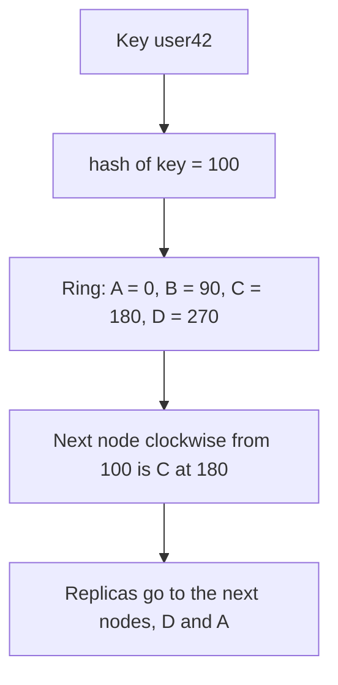

**In simple words:** jab data aur traffic bahut bada ho jaata hai to ek relational server toot jaata hai. McCreary aur Kelly batate hain ki NoSQL systems big data ko **char tareeke** se sambhalte hain: query ko data ke paas bhejo, hash rings se data barabar baanto, replication se reads scale karo, aur database queries ko data nodes mein barabar baante. <Cite id="big-data-intro-nosql" /> <Cite id="nosql-intro-gfg-intro" />

1. **Query ko data ke paas bhejo, data ko query ke paas nahi.** Terabytes ko network pe bhejna slow hai. Iski jagah chhoti query har node ko bhejo, wo apne local data mein dhoondhe aur sirf chhote answers lautaye. MapReduce yehi karta hai, task ko us node pe chalakar jahan block stored hai. *Analogy: saare students ko ek hall mein laane ki jagah har school mein ek teacher bhejo.*
2. **Hash rings se data barabar baanto.** Hash function key ko number banata hai. Numbers ek circle pe rakhe jaate hain, aur har node circle ka ek hissa own karta hai. Key us pehle node pe store hoti hai jo uski hash value se ghoomte hue milta hai. Node judne ya jaane par data ka sirf chhota hissa hilta hai. <Cite id="nosql-intro-dynamo" />
3. **Replication se reads scale karo.** Data ke har tukde ki kai copies alag nodes pe rakho. Reads kisi bhi copy pe ja sakte hain, to zyada copies ka matlab zyada reads per second, aur copies node failure se bhi bachati hain. <Cite id="nosql-intro-mongo-repl" />
4. **Database queries ko data nodes mein barabar baante.** Router ya nodes khud har request ko aise node pe bhejte hain jiske paas data ho aur jo busy na ho, to koi node hot spot nahi banta. <Cite id="nosql-intro-mongo-shard" />

<Cite id="nosql-intro-dynamo" loc="diagram" />

**Ring kyun, `hash mod N` kyun nahi:** `hash mod N` mein nodes ki sankhya $N$ badalne par lagbhag har key hil jaati hai. Ring mein sirf naye node se pehle ki keys hilti hain. Jaise 150 pe node E jodne par sirf wo keys E ko milti hain jinki hash 91 se 150 ke beech hai, jo pehle C ki thi.

| Problem | NoSQL ka jawab |
|---|---|
| Bade data ko hilana slow hai | Query ko data ke paas bhejo |
| Uneven load aur growth | Hash ring data barabar baantti hai |
| Bahut zyada reads, node failure | Replication |
| Hot spots | Queries ko barabar baanto |

**Conclusion:** in ideas se NoSQL systems saste nodes jodkar badhte hain, bahut users ko serve karte hain aur failures se bach jaate hain. Ye ek bade hote server ki jagah shared-nothing scale-out hai.

Exam mein English mein likho: "NoSQL handles big data by moving the query to the data, using hash rings, replication for reads, and distributing queries evenly."
