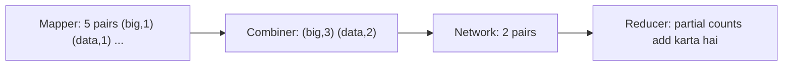

**In simple words:** **combiner** ek chhota optional reducer hai jo **mapper wali hi machine** par, mapper ke apne output par, shuffle se pehle chalta hai. Ye repeated keys ko local hi add kar deta hai, to reducers tak network par bahut kam pairs jaate hain. Ye sirf speed-up hai: final answer combiner ke saath ya bina, same hi aana chahiye. <Cite id="hadoop-ecosystem-mmds" loc="§2.2.4" /> <Cite id="hadoop-ecosystem-dean2004" loc="§4.3" />

**Combiner ka role**

1. **Network traffic kam.** Machines ke beech ka network job ka sabse slow hissa hai. Combiner map output ko bhejne se pehle chhota kar deta hai.
2. **Shuffle tez, disk ka kaam kam.** Sort, write aur copy karne ke liye data kam hota hai.
3. **Reducers halke.** Har reducer ko bahut saare 1 ki jagah kuch partial sums milte hain.

**Example (word count).** Mapper M1 "big data big data big" padhta hai. Mapper M2 "big is data" padhta hai.

| | M1 output | M2 output | Reducers ko bheje gaye pairs |
|---|---|---|---|
| Combiner ke bina | (big,1) (data,1) (big,1) (data,1) (big,1) | (big,1) (is,1) (data,1) | 5 + 3 = 8 |
| Combiner ke saath | (big,3) (data,2) | (big,1) (is,1) (data,1) | 2 + 3 = 5 |

Reducer phir partial counts add karta hai: big = 3 + 1 = 4, data = 2 + 1 = 3, is = 1. Dono cases mein answer same hai, bas network par 3 pairs kam gaye.

**Condition.** Reduce operation **associative aur commutative** honi chahiye (sum, count, max, min), kyunki Hadoop combiner ko zero, ek ya kai baar chala sakta hai. **Average ke liye galat hai**: averages ka average asli average nahi hota, isliye (sum, count) pairs bhejo. Combiner key ya value ka type change nahi kar sakta. <Cite id="hadoop-ecosystem-apache-mr-tutorial" /> <Cite id="mapreduce-gfg-mr" />

**Conclusion:** combiner ek local mini-reduce hai jo result badle bina network par shuffle hone wala data kam kar deta hai.

Exam mein English mein likho: "A combiner is a local reducer that runs on the map output before the shuffle to reduce network traffic."
