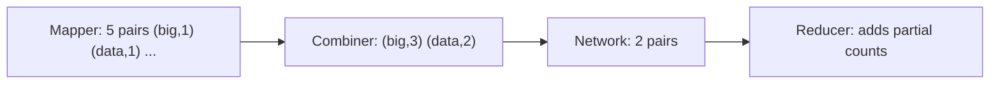

**In simple words:** a **combiner** is a small optional reducer that runs on the **same machine as the mapper**, on the mapper's own output, before the shuffle. It adds up repeated keys locally, so far fewer pairs travel over the network to the reducers. It is a speed-up only: the final answer must be the same with or without it. <Cite id="hadoop-ecosystem-mmds" loc="§2.2.4" /> <Cite id="hadoop-ecosystem-dean2004" loc="§4.3" />

**Role of the combiner**

1. **Less network traffic.** The network between machines is the slowest part of a job. A combiner shrinks the map output before it is sent.
2. **Faster shuffle and less disk work.** There is less data to sort, write and copy.
3. **Lighter reducers.** Each reducer receives a few partial sums instead of many 1s.

**Example (word count).** Mapper M1 reads "big data big data big". Mapper M2 reads "big is data".

| | M1 output | M2 output | Pairs sent to the reducers |
|---|---|---|---|
| Without combiner | (big,1) (data,1) (big,1) (data,1) (big,1) | (big,1) (is,1) (data,1) | 5 + 3 = 8 |
| With combiner | (big,3) (data,2) | (big,1) (is,1) (data,1) | 2 + 3 = 5 |

The reducer then adds the partial counts: big = 3 + 1 = 4, data = 2 + 1 = 3, is = 1. The answer is the same in both cases, with 3 fewer pairs on the network.

**Condition.** The reduce operation must be **associative and commutative** (sum, count, max, min), because Hadoop may run the combiner zero, one or many times. It is **wrong for average**: an average of averages is not the true average, so send (sum, count) pairs instead. A combiner cannot change the key or value types. <Cite id="hadoop-ecosystem-apache-mr-tutorial" /> <Cite id="mapreduce-gfg-mr" />

**Conclusion:** a combiner is a local mini-reduce that cuts the data shuffled across the network without changing the result.
