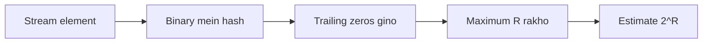

**In simple words:** **Flajolet-Martin (FM) algorithm** ek lambi stream mein distinct elements ki sankhya bahut kam memory se estimate karta hai. Har dekha hua element yaad rakhne ke liye distinct elements jitni memory chahiye, jo arbon items ke liye bahut zyada hai. <Cite id="stream-counting-fm1985" /> <Cite id="stream-counting-mmds-home" loc="§4.4" /> <Cite id="stream-counting-wiki-countdistinct" />

**Kaise kaam karta hai**

1. Har element ko hash karke binary number banao.
2. Hash ke **trailing zeros** gino aur sirf sabse bada count $R$ yaad rakho.
3. Distinct count ka estimate $2^R$ hai. Jis hash ke end mein $r$ zeros hon uski chance $1/2^r$ hoti hai, to $R$ zeros dikhne ka matlab hai lagbhag $2^R$ alag elements aaye. Repeat elements ka hash same aata hai, isliye $R$ nahi badalta.

<Cite id="stream-counting-gfg-fm" loc="diagram" />

Ek hash se rough answer milta hai, isliye real systems kai hashes use karke unhe combine karte hain. Modern improvement **HyperLogLog** hai. <Cite id="stream-counting-hll2007" />

**Do real-life applications**

1. **Website ya app ke unique visitors.** Aaj kitne alag users ya IP addresses aaye, bina sabko store kiye. Redis mein HyperLogLog ye karta hai (`PFCOUNT`). <Cite id="stream-counting-redis-hll" />
2. **Distinct search queries.** Search engine bina har query store kiye ye gin sakta hai ki is mahine kitni alag queries aayi. <Cite id="stream-counting-mmds-home" loc="§4.4" />

**Conclusion:** FM ek chhote number se stream ke distinct elements estimate karta hai, aur answer approximate hota hai.

Exam mein English mein likho: "The Flajolet-Martin algorithm estimates the number of distinct elements in a stream as 2^R, where R is the largest number of trailing zeros in the hashed values."
