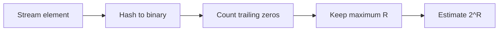

**In simple words:** the **Flajolet-Martin (FM) algorithm** estimates the number of distinct elements in a long stream using very little memory. Keeping every element seen would need memory as big as the number of distinct elements, which is too much for billions of items. <Cite id="stream-counting-fm1985" /> <Cite id="stream-counting-mmds-home" loc="§4.4" /> <Cite id="stream-counting-wiki-countdistinct" />

**How it works**

1. Hash every element to a binary number.
2. Count the **trailing zeros** of the hash and keep only the largest count $R$.
3. Estimate the distinct count as $2^R$. A hash ending in $r$ zeros has chance $1/2^r$, so seeing $R$ zeros suggests about $2^R$ different elements. Repeats give the same hash, so they never change $R$.

<Cite id="stream-counting-gfg-fm" loc="diagram" />

One hash gives a rough answer, so real systems use many hashes and combine them. The modern improvement is **HyperLogLog**. <Cite id="stream-counting-hll2007" />

**Two real-life applications**

1. **Unique visitors of a website or app.** Count how many different users or IP addresses visited today without storing all of them. HyperLogLog does this in Redis (`PFCOUNT`). <Cite id="stream-counting-redis-hll" />
2. **Distinct search queries.** A search engine can count how many different queries it received this month without keeping every query. <Cite id="stream-counting-mmds-home" loc="§4.4" />

**Conclusion:** FM estimates distinct elements in a stream from one small number, at the cost of an approximate answer.
