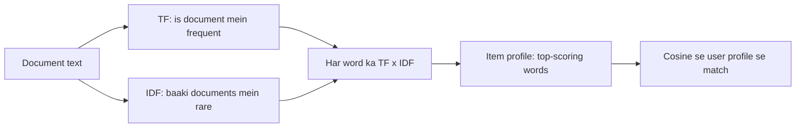

**In simple words:** content-based filtering mein har item (news article, blog, movie description) ko uske **important words** se describe karte hain. **TF-IDF** ye words chunta hai: koi word document mein important tab hai jab wo **us document mein frequent** ho (TF) lekin **baaki documents mein rare** ho (IDF). <Cite id="recommendation-systems-mmds-slides" /> <Cite id="recommendation-systems-wiki-tfidf" />

**TF (term frequency).** Ek term ek document mein kitni baar aaya, ise us document ke sabse frequent term ke count se divide karte hain, taaki lambe documents ko unfair advantage na mile:

$$
\text{TF}_{ij} = \frac{f_{ij}}{\max_k f_{kj}}
$$

Yahan $f_{ij}$ matlab term $i$ document $j$ mein kitni baar aaya.

**IDF (inverse document frequency).** Term saare documents mein kitna rare hai. $N$ documents mein se $n_i$ mein term $i$ ho to:

$$
\text{IDF}_i = \log_2 \frac{N}{n_i}, \qquad \text{TF-IDF}_{ij} = \text{TF}_{ij} \times \text{IDF}_i
$$

"the" jaisa word har document mein hota hai, to $n_i = N$, IDF $= 0$ aur uska score 0. Dusri books TF aur IDF ke thode alag versions use karti hain, isliye likho ki tum kaunsa use kar rahe ho.

**Example.** $N = 8$ articles. Article 1 mein "robot" 6 baar (sabse zyada), "movie" 4 baar aaya. "Robot" 2 articles mein hai aur "movie" saare 8 mein.

| Word | TF | IDF | TF-IDF |
|---|---|---|---|
| robot | 6/6 = 1 | $\log_2(8/2) = 2$ | 2 |
| movie | 4/6 = 0.67 | $\log_2(8/8) = 0$ | 0 |

"Robot" article 1 ko describe karta hai. "Movie" har jagah common hai, isliye bekaar hai.

<Cite id="recommendation-systems-gfg-cb" loc="diagram" />

**Content-based filtering mein use:** top words (ya poora TF-IDF vector) item profile banate hain. User profile user ke pasand kiye items se banta hai, aur unseen items ko unke profile ke user profile se cosine ke hisaab se rank karte hain. <Cite id="recommendation-systems-google-cb" />

**Conclusion:** TF batata hai ki word document ke andar kitna important hai, IDF batata hai ki wo documents ke beech kitna special hai, aur dono ka product wo words chunta hai jo item ko describe karte hain.

Exam mein English mein likho: "TF-IDF scores a word high if it is frequent in the document but rare in the other documents."
