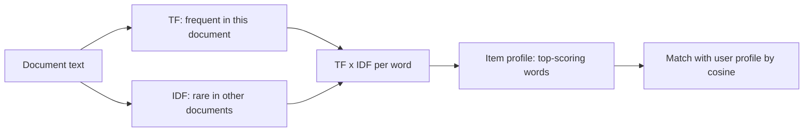

**In simple words:** in content-based filtering every item (a news article, a blog, a movie description) is described by its **important words**. **TF-IDF** picks those words: a word is important in a document if it is **frequent in that document** (TF) but **rare in the other documents** (IDF). <Cite id="recommendation-systems-mmds-slides" /> <Cite id="recommendation-systems-wiki-tfidf" />

**TF (term frequency).** How often a term appears in one document, divided by the count of the most frequent term in it, so that long documents get no unfair advantage:

$$
\text{TF}_{ij} = \frac{f_{ij}}{\max_k f_{kj}}
$$

Here $f_{ij}$ is the number of times term $i$ appears in document $j$.

**IDF (inverse document frequency).** How rare the term is across all documents. With $N$ documents and $n_i$ of them containing term $i$:

$$
\text{IDF}_i = \log_2 \frac{N}{n_i}, \qquad \text{TF-IDF}_{ij} = \text{TF}_{ij} \times \text{IDF}_i
$$

A word such as "the" is in every document, so $n_i = N$, IDF $= 0$ and its score is 0. Other books use slightly different versions of TF and IDF, so write which one you use.

**Example.** $N = 8$ articles. In article 1 "robot" appears 6 times (the most), "movie" 4 times. "Robot" is in 2 articles and "movie" in all 8.

| Word | TF | IDF | TF-IDF |
|---|---|---|---|
| robot | 6/6 = 1 | $\log_2(8/2) = 2$ | 2 |
| movie | 4/6 = 0.67 | $\log_2(8/8) = 0$ | 0 |

"Robot" describes article 1. "Movie" is common everywhere, so it is useless.

<Cite id="recommendation-systems-gfg-cb" loc="diagram" />

**Use in content-based filtering:** the top words (or the whole TF-IDF vector) form the item profile. The user profile is built from the items the user liked, and unseen items are ranked by the cosine of their profiles with it. <Cite id="recommendation-systems-google-cb" />

**Conclusion:** TF measures how important a word is inside a document, IDF measures how special it is across documents, and their product picks the words that describe an item.
